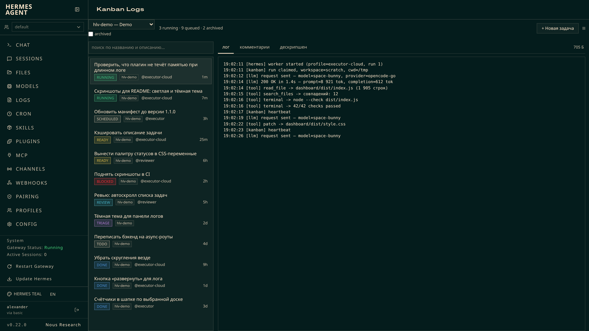
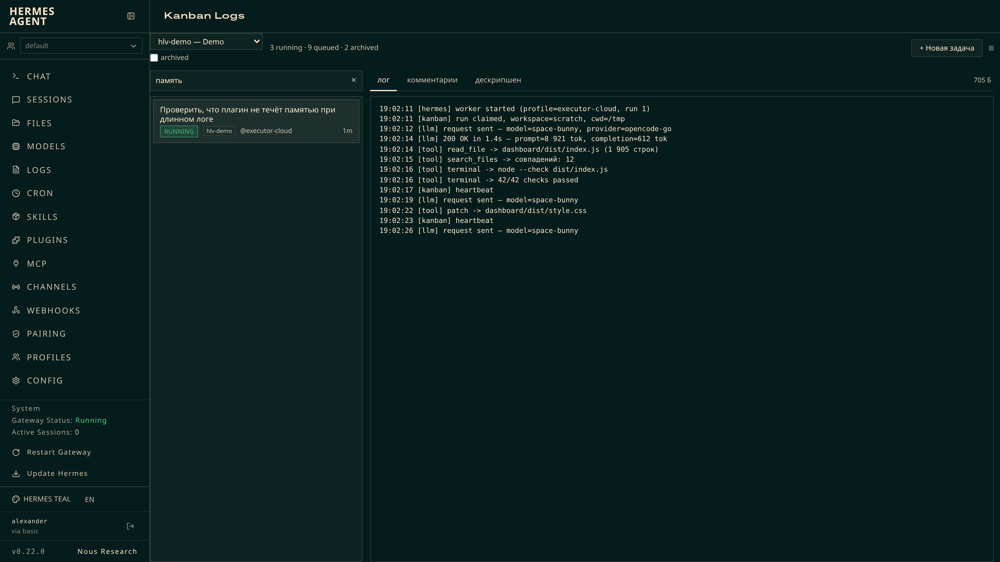
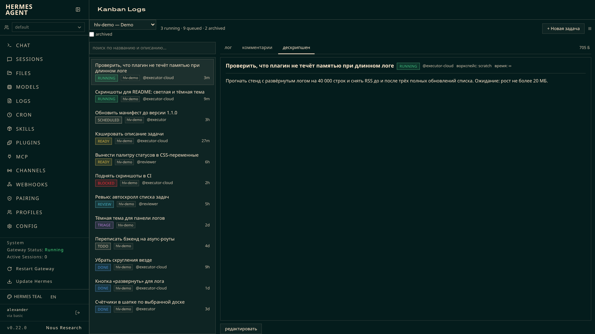
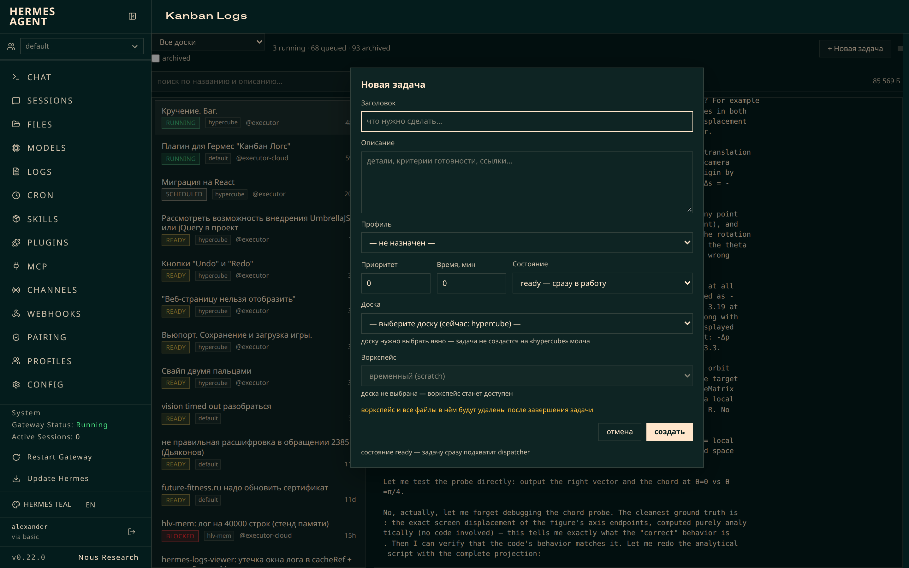
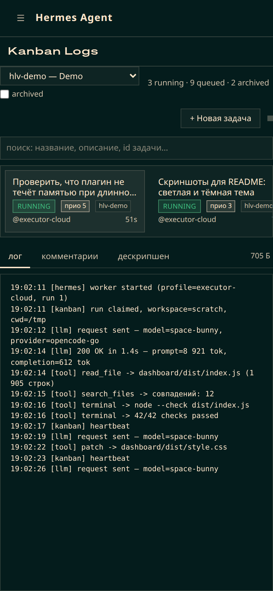
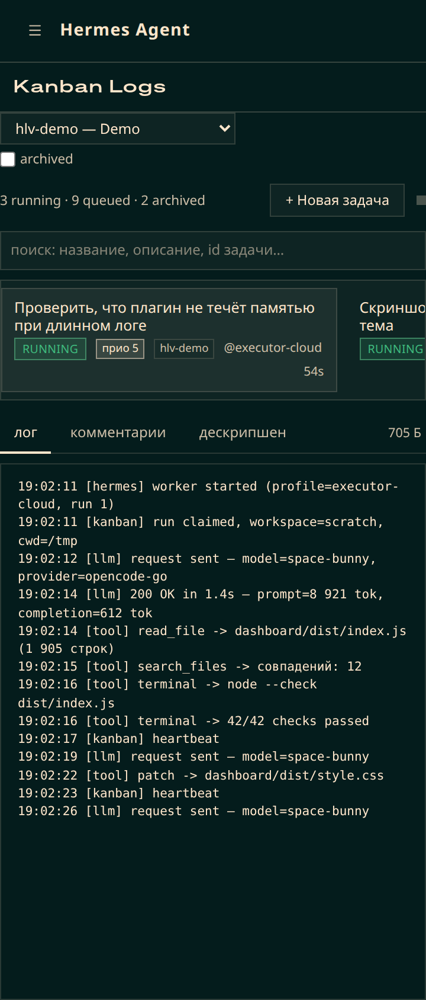

<div align="center">

# hermes-logs-viewer

**The worker's live log next to the task list — as a tab of the Hermes dashboard.**

[](dashboard/manifest.json)
[](tests/render_test.js)


</div>

---



The **Kanban Logs** tab opens in the Hermes web dashboard (`hermes dashboard`, port 9119)
and shows two halves of the same work: **on the left** every task of every board, **on the
right** the log of the selected task, catching up live as long as you have not scrolled up.

None of this needs configuring: the plugin draws nothing of its own beyond the two
panes, and takes boards, tasks, profiles and the log from the **bundled kanban plugin**.

---

## Contents

- [What it does](#what-it-does)
  - [Search by title, description and task id](#search-by-title-description-and-task-id)
  - [Live log](#live-log)
  - [Live transcript](#live-transcript)
  - [Main tab: the whole task card](#main-tab-the-whole-task-card)
  - [Comments](#comments)
  - [The runs tab: run history](#the-runs-tab-run-history)
  - [The files tab: card attachments](#the-files-tab-card-attachments)
  - [New task](#new-task)
  - [Task order in the list](#task-order-in-the-list)
  - [Live workers: processes, not cards](#live-workers-processes-not-cards)
  - [Mobile view](#mobile-view)
  - [What a task row shows](#what-a-task-row-shows)
  - [Boards and statuses](#boards-and-statuses)
- [Installation](#installation)
- [Screenshots](#screenshots)
- [How it works](#how-it-works)
  - [Live model stream: why it needs an agent hook](#live-model-stream-why-it-needs-an-agent-hook)
- [Verification](#verification)
- [Limitations](#limitations)
- [License](#license)

---

## What it does

### Search by title, description and task id



Above the task list sits a search box. The filter fires **on every keystroke**: no Enter,
no debounce.

- it searches the **title**, the **description** (`tasks.body`) and the **task id**,
  case-insensitively;
- the **id (`t_2d2e4f8f`) matches on a substring**, not exactly: people type ids from
  memory and paste them in pieces, so `t_2d2e` finds the card `t_2d2e4f8f`. The id needs
  no index — the hit shows up on the very first keystroke, without waiting for `/board`;
- the description comes from the bundled plugin's `/board` route — the only route that
  returns the body in full (the card list carries a 200-character preview). The index is
  built once per board and cached, so typing never waits on the network;
- while the query is non-empty the index is refreshed every 15 s — an edited description
  or a new card does not stay invisible to search;
- an empty result is spelled out on its own line (“nothing found for ‘…’”), so it cannot
  be mistaken for an empty board;
- the cross on the right of the box clears the query.

### Live log

The right pane is the tail of `~/.hermes/kanban/logs/<task_id>.log` (for a named board —
`…/kanban/boards/<board>/logs/`).

- it loads incrementally and **auto-scrolls down as long as you have not scrolled up**;
- the size is shown in **exact bytes** (“740 029 B”), not in rounded megabytes: the log
  window only means something next to the true file size. The human-readable form stays
  in the tooltip;
- **“expand ⤢”** drops `tail` — the route returns the whole file from byte 0. A note above
  the window says “start of file cut off (tail shown)”, and the button becomes
  “collapse ⤡”;
- the expanded view has a higher line limit (40 000 instead of 3 000) — the window grows
  from the start of the file rather than from the tail;
- **the scroll position is remembered per task**: if you were pinned to the bottom you
  come back to the bottom; if you were reading a particular spot you come back to the same
  offset, and auto-scroll will not yank you (a “Down ↓” button appears);
- while the first chunk is loading you get a preloader, not the “no log file yet” line.

### Live transcript

The second tab of the right pane is the **live transcript of the card**: what the agent
says and what its tools answer. Every message is a block with the role and time
(`--- assistant #63846`), the body in a monospaced block.

Why it is needed: from **v0.22.3** on, a card is executed by the **profile's owner
gateway**, and the dispatcher only starts a thin client that waits for a receipt. That
client writes **one line** into the card's log (`Session: local-<sha256>`) — so the log
file that used to BE the full transcript is now almost empty, even though the work is in
full swing. The transcript has not gone anywhere: it lives in the **owner profile's
store**, and the card points at it with the `owner_admitted` event (its payload carries
`session_id` and the store path).

- **new mode** (the owner executes the card): the transcript comes from the owner
  profile's store — that is the real text of the card's work;
- **old mode** (a separate worker process executed the card): the transcript stayed in
  the log, and the pane says so and points at the “log” tab;
- **the output is readable**: a tool result in the store is wrapped in JSON
  (`{"output": "…"}`), and in that shape the reader saw braces, quotes and line breaks
  written as the two characters `\n`. The pane unwraps it and shows the payload itself —
  with **real line breaks**. If the payload is structural (object/array) it is printed
  line by line instead of as one JSON string; the tail after the JSON document (for
  example the context of a found subdirectory) is preserved;
- **the agent's reasoning is visible** — what used to stream into the worker log. In the
  new scheme it is a separate column of the store, and the pane shows it as a
  “reasoning” block under the message;
- **every reasoning block is expanded, always** — each one is open by default, with no
  click per turn. The log used to print a `┌─ Reasoning ─┐` frame inline and it was open,
  so nothing has to be opened by hand: the block expands when it appears and stays
  expanded. A pane re-render (the live-feed poll) neither closes it nor reopens it — the
  reader may fold a reasoning block and it stays folded;
- **reasoning is not truncated** — the thinking block comes from the store in full and is
  shown in full. It used to be cut at 4000 characters with a “truncated” note next to it;
  a truncated thought says something other than what the model thought, so the limit is
  gone. **Ordinary** messages and tool output are still limited — their “truncated” note
  remains;
- **steps not from the agent are folded** — everything that is not an assistant turn (the
  user's message, a tool answer) shows as a folded block with a short summary; a click
  opens it. A transcript is mostly tool output, and open blocks drown out the very
  reasoning people open it for; the agent's own turn (its messages, reasoning and tool
  calls) stays expanded;
- **a live strip on top** — what the agent is doing **right now**, plus the run trail.
  The transcript is **history**: a message line appears when the model call that produced
  it has finished, so between two messages (and a call on a local model takes tens of
  seconds) the pane looks frozen while the agent is working. The strip shows:
  - the **session activity** from the store — what the owner gateway writes mid-turn:
    `receiving stream response`, `terminal command running (40s elapsed)`,
    `context compression in progress`, plus the model and tool call counters, the model
    and the age of the last activity;
  - the **run trail** — the owner profile's log lines for this session (`agent.log` next
    to the store): model calls with their latency and tokens, tools that ran, context
    compressions, errors. Service lines (“Re-anchored stale …”) are filtered out so the
    trail reads instead of turning into noise.

  The strip **sticks to the top** of the pane: the pane is scrolled to the tail, and
  without `position: sticky` the strip rode tens of thousands of pixels up and was not
  visible at all. The run trail is a short scrolling window pinned to its newest line; if
  the reader scrolled the trail up themselves, the strip no longer pulls them back down;
- **reasoning in the stream** — the last block of the list updates before your eyes: the
  tokens of the current model call arrive in the plugin from the core
  (`on_stream_start` / `on_stream_delta` / `on_stream_end`) and are collected in the owner
  profile's `plugin-data`, and the pane shows them as a separate block under the history.
  The transcript is history (an assistant line appears on the BOUNDARY of a call), so
  until now the pane looked frozen between two messages; now you can see the model think
  in between. The block is labelled `--- assistant (stream)`, its header says “writing…”
  and the call number; when the call is over it shows “answer finished” for a few seconds
  and then gives way to the same line, already arrived from the store.

  The stream **requires two settings in the owner profile**: the plugin enabled in
  `plugins.enabled` (otherwise its hooks are not subscribed) and
  `plugins.stream_reasoning_deltas: true` (without it the core does not broadcast
  reasoning to stream subscribers, and only visible text arrives). If the setting is
  missing the pane does not go silent: the block says what is missing and names the
  profile. If the agent simply is not calling the model right now, it says that honestly
  too instead of showing emptiness;

  What the block **does not do:** it does not stay in the list as history. The live block
  describes ONE current call: the next call overwrites it, and by then the previous text
  is already in the store as its own line;
- **the strip collapses** with the “collapse” button in its header: one line remains —
  what the agent is doing and whether the stream is running — while the run trail and the
  counters hide (their full text stays in the tooltip). The choice is stored in
  `localStorage` and applies to every card: it is a reading preference, not a property of
  the task. The same button expands it again;
- **the agent's turn is visible**: an assistant message that only called tools has an
  empty body (the calls live in their own column) — the pane shows the calls themselves
  (“→ terminal …”), because otherwise such a line would look empty;
- **polling runs only while the tab is open** (same as the “main” tab): reading the store
  is cheap, but rendering hundreds of messages every 2 s would steal frames from the tab
  being read. The tab loads when opened and stays live while open;
- the poll runs every **2 s**, and messages are fetched by monotonic `id` (a cursor), so
  the pane only grows and never re-reads anything;
- **auto-scroll down** until you scroll up (like the log), with a “Down ↓” button. The
  pin to the bottom happens **after** the new messages are rendered, not when the reply
  arrives — otherwise the pane would stay a screen behind the last message. The scroll
  mode is **per card**: scrolling up on one card does not push the next one down — it
  opens at its own tail and follows it. The pane re-pins to the tail every 0.5 s, so it
  also catches content growth that adds no messages;
- the DOM holds at most the **last 500 messages**: the cursor still walks **all** ids, so
  nothing is skipped — old messages simply leave the view;
- tool message bodies are truncated at **4000 characters**, and the truncation is marked
  in the message header — there is no silent cutting;
- the pane header carries the session id and the store path that was read.

The route `GET /api/plugins/hermes-logs-viewer/transcript?board=…&task_id=…&after=…&limit=…`
**only** reads (`mode=ro`) and never writes to the DB. If the board, the events or the
sessions are missing, the answer is `source: "none"` with an empty list, not a 500.

### Main tab: the whole task card



The last tab of the right pane holds the whole card in one place: the title, the header,
the priority, the state and the body of the task. These things used to be spread over two
tabs (“дескрипшен” and “прочее”): changing the state meant switching to the neighbouring
tab, while the body and the title were edited in a third one. Now everything that can be
changed on a card sits together, and the tab is called **“main”**.

> The screenshot above was taken before the tabs were merged — it still shows the old name
> “дескрипшен”. It cannot be re-shot without the repository owner's permission (see
> “Screenshots”), so the picture stays as it is and the caption says what it depicts.

Almost every edit goes through `PATCH /api/plugins/kanban/tasks/{id}` of the bundled
plugin, so no route of our own is needed and the tab works without restarting the
dashboard. The exception is “execution time” (see below): the bundled plugin only accepts
that field when a card is created.

- **The title** is edited **with the pencil next to it**: `✎` opens the field, `✓` saves,
  `✕` cancels. **Enter** saves, **Esc** cancels. An empty title is **refused** (“title
  cannot be empty”) — a card is never left with a nameless stub;
- **The description** is edited with the “редактировать” (“edit”) button, which turns the
  text into a textarea; saving is a `PATCH` with `{body}`. **Ctrl/Cmd+Enter** saves,
  **Esc** cancels. The editor opens **tall** (360 px by default, `resize: vertical` to
  grow it further): the description is the one field people write paragraphs into, and a
  short box showed four lines of it above the fold;
- **The priority** is edited with the pencil next to the value (**Enter** saves, Esc
  cancels; Ctrl+Enter works too). A non-numeric value is refused with an explanation
  instead of silently becoming 0 over a real priority;
- **The executor** is edited the same way, but its editor is a **combobox of installed
  profiles** rather than a free-text field: a typo in a profile name leaves the card in
  `ready` with nobody to run it. The list is the same one the create form offers, plus an
  explicit “— не назначен —” (unassigned) entry, which is how a card is unassigned. The
  write is the same bundled `PATCH` (`assignee`, an empty string clears it). If the card's
  current executor is a profile that is no longer installed, it is kept as an option
  marked “(не установлен)” so the closed control shows the real value instead of the first
  entry of the list. **Enter** saves, **Esc** cancels;
- **The pencil sits to the RIGHT of the value it edits** — next to the priority number,
  the title, the runtime and the executor, on the same line. That is how it reads as
  “this pencil edits this value” instead of as an unrelated button nearby;
- **The state** — one button per status the route actually accepts: `triage`, `todo`,
  `ready`, `scheduled`, `blocked`, `review`, `done`, `archived`. The button of the current
  state is **disabled**: a PATCH to the same state is a no-op that still writes an event;
- **there is deliberately no `running` button** — the route answers 400 for it (“Cannot
  set status to 'running' directly”, #19535): a card only gets into `running` through the
  dispatcher's claim. There is no point offering a button that can only refuse;
- **`done`, `blocked` and `archived` ask for confirmation** — they release the worker's
  claim. Exactly these three are confirmed by the bundled tab as well;
- **a route's refusal is visible to the user.** For example, `complete_task` refuses to
  finish a card without `result`/`summary`
  (`completion blocked: … has no result or summary evidence`) — the pane shows that text
  instead of pretending the transition happened;
- **Execution time** is edited with the pencil next to the value, in **minutes**. It is the
  timeout after which the dispatcher takes the worker off the card. In its inline form it
  has two faces: `∞` — no limit, and a number — how many minutes were granted. **0 minutes
  = no limit** (in the database that is `NULL`, not zero seconds: zero seconds would mean
  “stop immediately”). The edit writes `tasks.max_runtime_seconds` and affects the
  **current** card at once: the dispatcher reads that column on every check, so lowering
  the limit cuts an already running attempt short, not just the next one.

  The bundled plugin only accepts this parameter when a card is **created** — its
  `PATCH /tasks/{id}` has no `max_runtime_seconds` field. That is why a route of our own is
  needed here: `PATCH /api/plugins/hermes-logs-viewer/tasks/{id}/runtime` (body —
  `{max_runtime_seconds}`, where `0` and `null` mean “no limit”). The route writes the
  column in a transaction and records an `edited` event.

  **Because of this the “main” tab stops working without a dashboard restart:** our own
  `plugin_api.py` is mounted at process start, and a new route only reaches the browser
  after a restart. The rest of the tab's edits go through the bundled `PATCH` and are
  always live.

The card header: title, status badge, assignee, workspace and the time limit (`∞` when 0 =
infinite).

**An open editor is not overwritten by the poll.** The description is refreshed every 5 s,
and the “do not clobber an open editor” check used to read `descEdit` from the effect's
closure, which deliberately does not depend on that variable (otherwise the poll would
restart on every keystroke) — the value was frozen at `false` since the tab was opened, and
every tick pushed the server's body into the textarea. The text vanished within 5 s, and on
a card with an empty description the field simply went blank. The flag is now read through
a ref: the current value, and the poll keeps its cadence. The same goes for the title, the
priority, the runtime and the executor.


### Comments

The “comments” tab is the live thread of the task: the worker writes comments while it
works, and they appear in the thread without a reload. You can post your own comments from
the composer; after a successful post the thread is re-read at once, without waiting for
the poll.

Posting goes through the **bundled** route `POST /api/plugins/kanban/tasks/{id}/comments`,
not through the plugin's own route: the bundled router is mounted at process start and
lives without a dashboard reload (the same argument as for the task list, the log and the
edits). The plugin's own `POST /tasks/{id}/comments` works too, but it is tied to process
start — and on 2026-10-26 posting broke exactly on it: the async wrapper had lost its
`return await asyncio.to_thread(_run)`, the handler answered `200 null` and wrote nothing,
while reading the thread (GET) kept working — hence “display works, sending does not”. Both
sides are covered by tests (`tests/test_transcript.py`, `tests/render_test.js`).

#### Delivery state of a comment, and deleting one

Every comment carries a chip on its head line, because a comment is not the same thing
before and after the worker reads it:

| chip | meaning |
| --- | --- |
| **не доставлен** (yellow) | no worker has read this text yet |
| **агент видел** | the text is already in the worker's context |
| **от воркера** | the comment was written by the card's own assignee — the worker's own output |
| **доставка ?** | the card ran, but its transcript could not be checked — an unreadable store, or a run of the pre-v0.22.3 child-process scheme (the text went to the worker's log, not to a store) |

The `✕` button deletes the comment (and the `commented` row it left in the activity feed).
What the chip says decides what that deletion *means*:

- **не доставлен** — deleting really cancels the delivery. The row disappears before the
  next poll, so the worker never sees it. This is the case the operator asked for: a
  comment posted by mistake can be taken back.
- **агент видел** — deleting only rewrites the record. The text is already in the agent's
  context and will not be taken out of it, so the confirmation says exactly that, and the
  **route refuses with `409`** unless `force=1` is passed. The UI asks the second, narrower
  question and retries with `force=1`.
- **от воркера** / **доставка ?** — deleting is allowed after a confirmation that states the
  case; there is no delivery to cancel.

How “did the agent see it” is answered — not by guessing. A comment reaches a worker by one
of two paths, and **both leave its text in the worker's session store**:

1. **spawn** — `kanban_db.build_worker_context` renders the thread into the worker's first
   prompt (`## Comment thread`, and `kanban_db_context._ctx_comments` writes
   `comment from worker \`<author>\` at <stamp>:` followed by the body);
2. **mid run** — the live bridge `tools.kanban_tools.inject_new_comments_from_env` polls
   every ~6 s at a tool boundary and steers the worker with “New note on your kanban task
   from the operator (delivered mid-run)…”, one `- <author>: <body>` line per comment.

So the backend (`_comment_delivery`) reads the stores of **every** `owner_admitted` session
of the card — the same stores the transcript tab reads, `mode=ro` — and looks for the
comment's text in the user/system turns. Found ⇒ delivered (the channel and the moment are
reported too); absent from every session of a card that has run ⇒ not delivered yet.

A card from the **pre-v0.22.3 scheme** has no owner session at all: the worker was a child
process and its **log** (`<board>/logs/<task>.log`) was the transcript. For those the same
search runs over the log. Two consequences, and they are stated in the chip rather than
hidden: text found in the log ⇒ “агент видел”; text missing ⇒ “доставка ?”, *not* “не
доставлен”, because that log is one file per task and every attempt rewrites it — an
earlier attempt may well have read the comment. Only a comment written after the last
attempt ended is provably unread, and only that one is reported as pending.

The comparison drops **all whitespace** on both sides: a log wraps and hyphen-breaks long
text (`и поч / ему-то`), and a plain substring search would read a comment the worker
clearly saw as “not delivered”. Two further honest limits: the spawn prompt **truncates** a
long comment (`_ctx_cap`), which is why only the first 160 characters are searched; and a
heavily compacted session may no longer carry old text — both would read as “not
delivered”. A card that never ran has no transcript at all, and every comment on it is
`pending` — which is simply true.

Deletion is the plugin's own route (`DELETE /tasks/{id}/comments/{cid}`), not the bundled
one: the bundled kanban plugin has no delete at all. It writes in one transaction, removes
the paired `commented` event (matched by `created_at` + `author` + body length), and scopes
both statements by `task_id`, so a comment id cannot be deleted through someone else's card.

### The runs tab: run history

The attempt history used to be visible only in the bundled plugin (in the card's drawer)
and was absent from this pane altogether. Now it is a **separate tab**: one row per attempt
to take the card by a worker (`task_runs`).

What a row carries:

- **the outcome** — the word the dispatcher recorded (`completed`, `blocked`, `crashed`,
  `timed_out`, `reclaimed`, `review_requested`, …), or “running” while the run is not
  closed. The colour of the left edge is only a second signal (green/yellow/red); the word
  itself is printed on the row;
- **who ran it** (`@profile`) and **how long it took** (`42s`, `7m`, `2.4h`);
- **when** — “2d ago” with the exact `dd.mm hh:mm` in the tooltip, plus a line of facts:
  start, end, time limit, worker pid;
- **the handoff summary** in full, untruncated — that is what the tab is for: the worker
  reports through it, and it lives in `task_runs.summary`;
- **the error** of the run, if there was one;
- **metadata** — in a collapsible block; short metadata (≤300 characters) is expanded at
  once, long metadata is folded so that one attempt does not fill the whole pane.

The order is **newest first** (the route returns attempts in start order, the pane flips it
once when reading). The tab itself carries the **number of runs**.

The data comes from the same bundled `GET /api/plugins/kanban/tasks/{id}` as “main”: the
route returns a `runs` array, so **there is no route of our own** and no dashboard restart
is needed. The poll runs every 5 s and **only while one of the three “card” tabs is open**
(“main”, “runs”, “files”): it is the same request, and the log and comments do not pay for
it.

### The files tab: card attachments

A separate tab for attachments — with upload, download and delete. Before it there were no
attachments in the pane at all.

- **Upload** — the button opens a file picker (multiple files are allowed); the files go
  **one at a time, sequentially**, so that a partial failure names the file it stopped on;
- **Download** — a click on the **file name** (the name is the button: you click what you
  get). The download goes through `authedFetch` into a blob and is handed to the browser as
  an object URL: a plain `<a href>` carries no authorisation in the dashboard's token mode
  and would answer 401;
- **Delete** — `✕` on the right of the row, with a confirmation: the file is removed from
  the disk as well;
- a row carries the size and who uploaded it when;
- after an upload or a delete the card is **re-read at once**, without waiting for a poll
  tick.

All three operations go through **bundled** routes: `POST` and `GET`
`/api/plugins/kanban/tasks/{id}/attachments`, `GET` and `DELETE`
`/api/plugins/kanban/attachments/{id}`. The tab has no backend of its own — for the same
reason as the others: the bundled router is mounted at process start and is always alive.

An uploaded file sits next to the card (`stored_path` in the answer), and the worker reads
it with ordinary file tools — the tab hides nothing in a separate storage.

### New task



The “+ Новая задача” (“+ New task”) button in the header opens a form:

| field | what it is |
| --- | --- |
| Title | required, **Enter** — create |
| Description | the card's body |
| Profile | a select of installed profiles; **required** |
| Model | **provider first, then that provider's model**; prefilled with the profile's own model; changing the pair writes a per-task override |
| Priority | a number, 0 = default; higher — the dispatcher takes it earlier |
| Time, min | the worker's time limit **in minutes**; **0 = infinite** |
| State | `ready` (default) / `todo` / `scheduled` / `triage` / `blocked` |
| Board | any board from the list; **required, chosen explicitly** |
| Project | **every project of the profile**, tagged with its board; own ones first; empty = a card without a project; **enabled after a board is picked** |
| Workspace | `scratch` / `dir` / `worktree` + a path; **enabled after a board is picked** |

Nine decisions worth knowing:

- **The board and the profile are both required.** Until they are picked, both comboboxes
  are outlined in red and the “create” button is disabled. A picked value removes the red
  outline.
- **The profile is required because the card is not executed without it.** The dispatcher
  takes only cards with an assigned profile from the `ready` lane
  (`kanban_db_dispatch._lane_rows` + `_dispatch_lane_task`); an unassigned card sits in
  `ready` and waits forever. On a live dashboard that shows up in the gateway log: “kanban
  dispatcher stuck: ready queue non-empty for N consecutive ticks but 0 workers spawned”.
  If `kanban.default_assignee` is configured, unassigned cards are still taken — but that
  is an operator setting, not a choice of the form, so it cannot be relied on.
- **The board is required explicitly.** The form opens with an empty value and does not
  create without a picked board — a task must not silently land on `default` or on the
  board accidentally left in the header filter.
- **The workspace is locked until a board is picked.** It is derived from the board
  (`default_workdir` + `default_workspace_kind`), and picking a board overwrites it. If the
  field were active earlier, any user's choice would silently disappear after one click.
  So the `select` and the path are marked `disabled`, a hint under the field says “no board
  picked — the workspace will become available”, and the `title` says “pick a board first”.
- **Time is in minutes, the API in seconds.** The “Time, min” field is what a human plans
  in; what goes to the DB is `max_runtime_seconds`, so the conversion (`minutes × 60`) is
  done once on submit. 30 in the field = a 1800-second limit. In the form this is covered
  by an end-to-end test, not only by eye.
- **Workspace kind: the board sets the base, a project with a repository overrides it.**
  Once a board is picked, the form takes its `default_workspace_kind` — `worktree` if the
  board's directory is inside a git repository, otherwise `dir`, and `scratch` without a
  directory. **If a project whose `primary_path` is a git repository is picked, the kind
  becomes `worktree`**, even if the board suggested `dir`. This matters for the `ff` board:
  its `default_workdir` is the container `/home/alexander/src/ff`, not a repository, so its
  `default_workspace_kind` is always `dir`, and without this rule none of its projects would
  offer a worktree although branches are created there perfectly well. A project **without**
  a repository leaves the kind as the board's. The rule is implemented in `kindForProject`
  and applies only to the **default** value — the kind can always be switched by hand.
  Changing the board recomputes the kind from the board, and then, if a project is still
  picked, applies the project rule. The full table of “kind × project present” pairs is
  below.
- **Creation goes through the bundled kanban plugin's API**, so the card is
  indistinguishable from one created in the Kanban tab: its own row in the DB, a `created`
  event, resolution of the workspace and of the board's project.
- **The model is the profile's by default and can be overridden per card.** The “Model”
  field sits right under the profile combobox and is two selects: **provider first, then
  that provider's models** (a model belongs to a provider, so it is only offered once the
  provider is known). The pair opens on **the picked profile's own `model` + `provider`** —
  that is the worker's default, visible without a click — and an **untouched picker writes
  nothing**: `model_override`/`provider_override` stay NULL, so the card keeps following
  the profile if its config changes later. Changing the pair writes both keys
  (`create_task` refuses a provider without a model, and a model alone would be resolved
  against the profile's backend instead of the picked one); the gateway applies them on
  the card's next run (`gateway/session_kanban.py` → the worker policy's `model`/`provider`).
  “— как в профиле —” in the provider select returns to the default pair and locks the
  model list. The catalog is the bundled plugin's `/model-options` (the same substrate as
  the Models page), so the picker cannot offer a pair Hermes rejects; a provider the
  profile names but the curated catalog does not list stays in the list as a synthesised
  entry, exactly like a no-longer-installed profile in the assignee combobox. A card that
  carries an override says so in its meta line (`модель: provider · model`).
- **`todo`, `scheduled` and `blocked` are not created “out of the box”** — a card first
  appears in `ready` and is then moved by the same `PATCH` the bundled tab uses when a card
  is dragged. If the move does not go through on the first attempt, the plugin tries once
  more; if that fails too, it **writes into the header which state the card is actually
  in** instead of a silent “created”.

- **`scheduled` means “postponed, but not broken”.** A card in this state waits for a
  time, not for a person: the dispatcher **does not take it** (its lanes only carry
  `ready` and `review`), the claim is released, and it can be put back to work by moving
  it to `ready` — exactly what the bundled tab does with the “→ scheduled” button.

#### Project: the list and the anchors

**A project does not have to be tied to a board.** `projects.board_slug` is a nullable
column, and it means “where the project is used”, not “where it may be used”:

- a project created without `--board` has `board_slug = NULL` — and under the “projects of
  this board” filter it would be unreachable on **all** boards at once;
- `kanban_db._resolve_project_link` **does not check board membership at all**, so a card
  with a project of another board can and should be created. A board filter would forbid a
  legal call.

That is why the list is **every project of the profile**, ordered by membership:

1. projects tied to **this** board;
2. projects tied to **another** board;
3. untied ones (`board_slug` empty).

Every entry is tagged with its membership, otherwise the choice is unreadable:
`FF Front · ff`, `Hyper-Cube · hypercube`, `Something else · без доски` (“без доски” = no
board). Under the field it says how many of them belong to another board. The field is
locked until a board is picked: without a board there is nothing to sort by. An empty value
= a card without a project.

**Changing the board does not reset the choice** — the project stays picked and re-anchors
the path onto the new board. Only a project that **disappeared from the list** is reset
(for example one archived halfway through filling the form): an `id` that no longer exists
must not go into the payload.

A project is an **anchor**, and `kanban_db._resolve_project_link` treats it differently
depending on the workspace kind. The form follows the core, otherwise the card would run
somewhere other than where the selector showed. The full table — kind × project present:

| workspace | project picked | no project picked |
| --- | --- | --- |
| `dir` | `project_id` + `workspace_path = primary_path` of the project → the **project directory** | `workspace_path` = `board.default_workdir` |
| `worktree` | `project_id`, **no `workspace_path`** → the core itself creates `<primary>/.worktrees/<task-id>` and the branch `<slug>/<task-id>-<title>` | `workspace_path` = `board.default_workdir`, branch — a random `wt/<id>` |
| `scratch` | **nothing** (an explicit opt-out of the project, #106342) → `project_id` = NULL | **nothing** → `project_id` = NULL |

In short, by priority: **a project overrides the board** in the `dir` row (the path) and in
the `worktree` row (the path is dropped entirely, the root and the branch are set by the
project); under `scratch` the project is not sent at all.

Why exactly so — the `ff` board as a counter-example. Its `default_workdir` is
`/home/alexander/src/ff` — a **container, not a git repository** (`_git_toplevel` returns
`None`); three repositories live inside it. Hence:

- **`project_id` does not supply a path for the `dir` kind.** The core takes the path from
  `board.default_workdir`. A card “project `ff-front` + `dir`” without an explicit path
  would run in `/home/alexander/src/ff` instead of `/home/alexander/src/ff/ff-front-v1`.
  That is why the form **supplies `workspace_path = project.primary_path`** — it is not a
  decoration but a condition for the project choice to make any sense at all. The path
  stays editable: the substitution sets the default, but a manual edit wins.
- **For `worktree` the path is dropped from the payload, but not from the field.** The core
  materialises `<primary>/.worktrees/<task-id>` only while no path is sent
  (`_resolve_project_link` sets `project_repo` under `workspace_path is None`). The
  `default_workdir` left from the board would override the anchor — and no worktree would
  be created at all, because the container is not a repository. That is why
  `workspace_path` is **never sent**, while the “Path” field shows a **preview** of what
  `create_task` will create:

  ```
  /home/alexander/src/ff/ff-mobile/.worktrees/<task-id>
  ```

  The field is labelled “Path (preview)”, is rendered `readOnly` (not `disabled`, so the
  value can be read and copied), and both its `title` and the hint say that the value does
  not go into the task and that nothing of your own can be typed in. The field used to be
  empty with a single line of hint text — that read as “not set”, and the natural reaction
  (typing the board's directory) broke the anchor. The preview removes the cause itself:
  you see that the value is already there and need not be typed.

  The “do not send” rule is duplicated in `submitCreate` instead of resting on read-only
  alone: the worktree anchor must not depend on someone not editing the field. The opposite
  case — **a worktree without a project** — is left as it was: there the path is the
  repository to branch from, and it must be sent.
- **The mechanism does not work the other way:** `dir` has no branch at all
  (`branch_name` = NULL) — a branch is derived only for `worktree`.

**The form does not rely on `board.json.project_id`.** The core substitutes the board's
project automatically when `project_id is None` and the kind is not `scratch`. On the `ff`
board that field is currently `null`, but that cannot be relied on: fill it in and an
explicit project choice in the form would start being silently overridden. So a picked
project goes as an **explicit `project_id`**, while an empty choice goes as a **complete
absence of the key** in the payload (not `null`, not `""`). That way a card without a
project stays without one regardless of the board's setting.

**`scratch` is an explicit opt-out of the project** (#106342), and the decision is
recorded: with the `scratch` kind the project is **not sent at all**, the project selector
is **disabled**, and a hint under it says “scratch workspace — no project is attached, the
card is disposable”. Sending both a project and `scratch` is impossible: the core would read
the project as “tie me to this repository” and either raise the kind to `worktree` or invent
a worktree — that is, the UI would show one thing and the card would do another. A project
without `primary_path` is the only case where the root is unknown, so the form refuses to
create the card and explains why.

All of this is verified in two ways:

- `tests/render_test.js` — **what goes into the payload**: rebuilding the list and resetting
  a foreign project, `dir` → the project's `workspace_path` (and that it is **not** equal
  to the board's `default_workdir`), `worktree` → `workspace_path` **absent**, an empty
  project → `project_id` **not sent at all**;
- `tools/anchor_probe.py` — **what the core does with that payload**: it calls `create_task`
  directly and reads the row back, matching `<primary>/.worktrees/<task-id>`, the
  deterministic branch, and that `project_id` was not substituted from the board.

### Task order in the list

The order of the status groups is `running`, `ready`, `scheduled`, `blocked`, `review`,
`triage`, `todo`, `done`, `archived`. **`scheduled` sits after `ready` on purpose:** a
postponed card waits for a time and is not taken by a worker (`schedule_task`), so it must
not read as “next in the queue”.

Inside one status the cards stand not by heartbeat freshness but by what actually matters
for that status:

| statuses | order within the group |
| --- | --- |
| `ready` | **as in the dispatcher: `priority DESC, created_at ASC`** |
| `running` | **by priority, then whoever started earlier** |
| `done`, `archived` (finished) | **by completion time, newest first** |
| the rest (`todo`, `blocked`, `review`, `triage`, `scheduled`) | **by priority, higher first** |

- **`ready` is the run queue, and it shows the real run order.** Taken literally from
  `kanban_db_dispatch._lane_rows`: `ORDER BY priority DESC, created_at ASC`. The general
  rule “by priority, on a tie the freshest activity” would give `ready` the reverse order,
  and the list would promise an in-progress state the dispatcher will not deliver. The
  first `ready` row is the card that goes to work next.
- **`running` is not reshuffled by heartbeats.** The secondary key used to be
  `last_heartbeat_at`, which changes on every heartbeat: two cards with the same priority
  swapped places whenever one of the workers answered something, and the list shuffled
  under the cursor on a live board. Now the secondary key for `running` is `started_at`: it
  is stable for the whole run and also meaningful (whoever has been working longer is
  higher).
- a finished card's priority no longer decides anything — it is not in the queue, so “what
  finished last” is more useful than “what was more important”;
- for the other live cards, equal priorities are decided by activity freshness, then
  `board` and `id` — the order is stable and does not jump between polls.

**«Все доски» is ordered by the same rule, not by board.** The merged list used to be
built board by board (each board's rows sorted, then concatenated), which repeated every
status once per board: `running, ready, done` of board A, then the same for board B. On
one board the reader gets status groups, and that is what the merged view gives too —
status group first, then the group's own key across **all** boards; the board slug is only
a late tiebreak (after priority / completion time, before `id`). So a high-priority `ready`
card of the last board genuinely sits above a low-priority `ready` card of the first, and
each row's board badge says where it came from.

The rule is the same in the backend (`_sort_key` in `plugin_api.py`) and in the frontend
(`taskSortKey`), so a card inserted right after creation lands where the next poll would put
it. Both implementations are checked by their own set of tests, which compare the result
with the dispatcher's `ORDER BY` rather than with a second implementation of the same rule.

### Live workers: processes, not cards

Next to `5 running · 41 queued · 160 archived` sits a second counter: **how many worker
processes are alive right now, and on how many cards** — `2 воркера на 2 задачах`.

The two numbers are not the same thing, and that is the point. The left one counts
**cards** in `running`, i.e. what the board intends. The right one counts **processes**,
i.e. what the machine is really running. They disagree in both directions:

- **a worker outlives its card.** A card can leave `running` (done, review, blocked) while
  its process is still finishing the job — sometimes for minutes. The badge then reads
  `… · 1 доделывает` (“1 is still finishing”), the card's row carries the same label, and
  the panel says how long it has been going since the transition;
- **a card outlives its worker.** The process is gone (claim expired, the reap has not
  caught up) while the card still says `running`. The badge reads `… · 1 без воркера`
  (“1 without a worker”).

Clicking the badge opens **“Кто сейчас работает”** — one row per process: the card's title,
the phase, the duration, the profile, the card's status and board, the pid. Disagreements
are sorted first, and clicking a row opens that card (switching the board filter when the
card lives on another board).

Liveness is decided by asking `/proc`, not the board: the pid must be alive **and** its
restart-stable fingerprint (boot/instantiation epoch + process start time) must match the
one recorded at spawn, so a recycled pid is never read as “our worker”. Pid and fingerprint
are kept on the **closed** `task_runs` row — that is exactly why the kernel keeps them —
so a worker that outlived its own completion is still visible. A row whose claim lock
belongs to another host is reported as `remote`: it cannot be verified from here, and it is
never counted as verified.

On a narrow screen the second half of the label shortens to `· 3 задачи` (the same pair of
numbers in fewer characters) and the details stay behind a tap, because a phone has no
hover.

One more difference is worth naming, because it looks like a bug otherwise: the header
counter counts `scheduled` cards as `running` (that is its older behaviour), while a parked
card has no process and should not have one. When scheduled cards exist, the panel says so
in its own line — “the `N running` counter includes the scheduled ones: N of them”.

### Mobile view

On a narrow screen the task list becomes **horizontal** — and the variant depends on the
width: **above 380px it is a list**, and **at 380px and narrower it is a carousel**.





The shared part (the `max-width: 1023px` media query) is the same for both:

- scrolling goes **along X** (`overflow-x: auto`), along Y it is locked;
- **the list autoscrolls along the axis it actually scrolls** (`isCarousel()` →
  `scrollLeft` instead of `scrollTop`), so picking a card on a phone scrolls it sideways
  instead of trying to move the list up;
- on the desktop the media query does not apply and the list stays a vertical column.

How the variants differ, and why the boundary is exactly there:

| list width | variant | card | scroll-snap |
| --- | --- | --- | --- |
| **> 380px** | a horizontal **list** | `clamp(200px, 45%, 320px)` — several cards in frame | off (`none`) |
| **≤ 380px** | a **carousel** | `82%` — one card, the next one peeking out | `x mandatory`, snapping to the left edge |

- **“one card per screen” is not universally good.** At 390px it ate the whole row: one
  task, the log pushed below the fold, and paging one card at a time. Above 380px several
  cards fit into the same row — and the list reads as a list;
- **below 380px the second card would be a stub** like “Скиллы для…”, and paging is more
  honest: the card is read in full and the finger knows there is more to the right;
- in both variants the **meta-line chips wrap** instead of being cut: the status, priority,
  board, profile, comment count and time did not fit one line, and the tail vanished behind
  `overflow: hidden` with no hint at all.

The rule is verified in **real Chromium** at three viewports — 390px (list), 360px
(carousel) and 1440px (vertical column): `tests/carousel_test.js`.

### What a task row shows

Under the card's title sits a meta line: **status, priority, board, profile, comment count,
“how many minutes ago”**.

- **the priority is labelled on every card**, including `прио 0` (short for “приоритет 0”,
  priority 0). The list is sorted by exactly that, so the number the order is built on must
  be visible; `0` is a value too (“no explicit priority”), not “no data”, and hiding it
  would be the same kind of mismatch;
- the label comes from `sortInputs(t)` — the same value the order is computed from and
  `data-priority` is written from, so the badge cannot drift away from the card's position;
- the stand compares the label with `data-priority` **and** with the live board (`/board`),
  not with a constant from the plugin itself.

### Boards and statuses

- the board selector in the header filters the list; “All boards” (the merged view) comes
  first. The choice is remembered in `localStorage` and survives a reload; if a board
  disappears, the filter returns to “All boards” by itself;
- **the board label is shown in full.** The selector used to be capped at 180px, and a
  native `<select>` does not ellipsize — it just cuts the text: on this data
  `hlv-mem — Bench (memory)` did not fit by 23px and `hypercube — Hyper-Cube` by 8px, and
  the closed selector read as “hypercube — Hyp…” — that is, as a broken switcher. It now has
  its own class `.hlv-board-select` (`width: auto; max-width: 100%`), and the full label is
  duplicated in `title` for the case when the room really is short; the actual clipping is
  measured in the browser against an uncapped
 twin of the same selector (`tools/board_label_fit.js`), not “by eye”;
- the **“archived”** checkbox lives under the board selector, in the same block;
- each of the **9 statuses has its own badge colour** — the palette is taken from the
  bundled kanban plugin (`.hermes-kanban-dot-*`), not invented here;
- the counters in the header count **what is shown** (with a board picked — its tasks);
- active tasks (`running` → `scheduled` → `ready` → …) on top, `archived` at the bottom,
  and inside a group — by the rule from
  [“Task order in the list”](#task-order-in-the-list).

---

## Installation

You need an installed Hermes with the kanban plugin (it ships with the dashboard).

```bash
git clone https://github.com/alex-dubatov/hermes-logs-viewer.git
cd hermes-logs-viewer

# 1. put the plugin into ~/.hermes/plugins/
cp -r dashboard ~/.hermes/plugins/hermes-logs-viewer

# 2. enable it (without this the backend is not mounted)
hermes plugins enable hermes-logs-viewer

# 3. open the dashboard
hermes dashboard --no-open
```

The **Kanban Logs** tab appears in the dashboard's left navigation.

**The live reasoning stream** (the last block of the “transcript” tab) requires the plugin
to be installed and enabled in **the profile that executes the card** — not only in the one
where the dashboard is open. Every profile has its own plugin directory, so for the other
profiles the plugin is installed as a symlink to the same copy:

```bash
# for every profile whose cards you look at (the name comes from `hermes profile list`)
ln -s ~/.hermes/plugins/hermes-logs-viewer \
      ~/.hermes/profiles/<profile>/plugins/hermes-logs-viewer

# enable the plugin in that profile and allow it the model's reasoning
hermes --profile <profile> config set plugins.enabled \
  '["homeassistant","prompt-notes","vk-platform","hermes-logs-viewer"]'
hermes --profile <profile> config set plugins.stream_reasoning_deltas true
```

Without the second key the core gives the plugin only the visible answer text, without
reasoning; the pane then says so right under the block. Details are in
“[Live model stream](#live-model-stream-why-it-needs-an-agent-hook)”.

**Upgrading.** **Frontend** edits (`dist/`) are picked up by reloading the page — the assets
are served with `no-store`, so no dashboard restart is needed. Editing `plugin_api.py`
(adding or removing routes) requires `systemctl --user restart hermes-dashboard`.

---

## Screenshots

> **Do not refresh the screenshots without the repository owner's permission** (rule from
> 2026-10-19, tightened on 2026-10-21). The commands below **overwrite** the committed PNGs
> in `docs/`, and `seed_demo.js` additionally creates a **real** board on the live
> dashboard. Neither may be done without asking — the owner found out the hard way. Even if
> a new feature obviously “asks” for a picture: asking in advance is cheaper than
> explaining afterwards. If permission is granted, always finish with
> `seed_demo.js --clean` so no board is left behind.
>
> **Do not create tasks for the sake of screenshots** (2026-10-21). The rule covers
> preparing data as well, not just shooting: demo cards for pictures are not created
> without asking. Verifying functionality needs no live-dashboard tasks — there are stands
> (`tests/render_test.js`, `tests/carousel_test.js`) that check the DOM and the behaviour.
> The full rule for agents is in [`AGENTS.md`](AGENTS.md).

Every picture in this README was taken from the **live dashboard** and shows **fake data** —
the `hlv-demo` board, created by a script and deleted together with its logs. No real task
title ever lands in the repository.

```bash
# 1. a live dashboard session into a cookie jar
curl -s -c /tmp/hlv.cookies -X POST http://127.0.0.1:9119/auth/password-login \
  -H 'Content-Type: application/json' \
  -d '{"provider":"basic","username":"<user>","password":"<pass>"}'

# 2. fake tasks on the disposable hlv-demo board
node tools/seed_demo.js

# 3. shots into docs/
node tools/screenshots.js
node tools/narrow_shots.js        # both narrow-layout variants (list and carousel)

# 4. remove the board together with the logs
node tools/seed_demo.js --clean
```

`tools/check_screenshots.js` runs the same scenario and **checks the DOM** at every shooting
point — that the frame really shows the demo board, that search narrowed the list, that the
log is not empty. That is how the README's claims are verified rather than assumed:

```bash
node tools/check_screenshots.js     # 20/20 frame checks
```

`tools/narrow_shots.js` shoots both narrow layouts and **checks itself**: at 390px it waits
for more than one card in frame with snapping off, at 360px for `x mandatory`, and the shot
is taken only if the scenario matched. Otherwise the old picture in the README would
silently disagree with the CSS.

The Playwright and Chromium paths can be overridden with the `PLAYWRIGHT_PATH` and
`CHROME_PATH` variables.

---

## How it works

```
~/.hermes/plugins/hermes-logs-viewer/
├── plugin.yaml           # manifest: the tab + the model-stream subscription (hooks)
├── __init__.py           # on_stream_* hooks: tokens of the current call → plugin-data
├── dashboard/
│   ├── manifest.json     # tab registration
│   ├── plugin_api.py     # own backend: only what kanban does not have
│   └── dist/
│       ├── index.js      # the whole frontend, one IIFE with no build step
│       └── style.css     # dashboard CSS variables only, no rounded corners
├── tests/render_test.js  # stand: jsdom + live dashboard, clicks on the real UI
├── tools/                # demo data, screenshots, browser checks
└── docs/                 # README pictures
```

**The frontend** is a single IIFE script with no build step. It takes React and `fetchJSON`
from `window.__HERMES_PLUGIN_SDK__` and registers the tab through
`window.__HERMES_PLUGINS__.register`.

**Almost no backend of its own.** Board lists, profiles, task creation, the description and
the log itself come from `/api/plugins/kanban/…`. That is not an optimisation but an
availability requirement: the bundled plugin's router is mounted at process start and is
therefore **always live**, whereas a new route here only reaches the browser after
`systemctl --user restart hermes-dashboard` — and a restart is unavailable from headless
mode. A copy of those endpoints here would also drift away from the original.

Our own `plugin_api.py` serves exactly what the bundled plugin lacks:

| route | what for |
| --- | --- |
| `GET /tasks/all` | all tasks of **all boards** as one merged list; a board with a broken/missing DB is skipped, so one broken board does not hide the others |
| `GET/POST /tasks/{id}/comments` | comments: insert into `task_comments` + a `commented` event, like `kanban_db.add_comment`; the GET also reports, per comment, whether the worker has already read it |
| `DELETE /tasks/{id}/comments/{cid}` | delete one comment (+ its paired `commented` event); `409` when the worker has already seen it, unless `force=1` |
| `GET /projects[?board=]` | projects with their `board_slug` and `primary_is_repo` — what the bundled plugin lacks (see below) |
| `GET /transcript` | the card's live transcript from the owner profile's store (see below) |
| `GET /tasks/{id}/live` | tokens of the **current** model call: the live reasoning block (see below) |

**The transcript is the only route that looks into someone else's storage.** The bundled
plugin cannot: the path to the owner profile's store lives in the card's `owner_admitted`
event, and the board and the store are different databases. The route reads the event, takes
`session_id` and `db` from its payload (the path is already absolute and exact — no guessing
of the profile), and opens the **store in `mode=ro`**: the gateway's live WAL store can be
read from another process, but it must not be written to.

The `/transcript` answer carries three parts:

| field | what it is |
| --- | --- |
| `messages` | the dialogue history: store rows by `session_id`, starting at the `after` cursor |
| `live` | what the agent is doing **right now**: `last_activity_description`, `last_activity_at`, `activity_age`, the `api_call_count`/`tool_call_count`/`input_tokens`/`output_tokens` counters, `model`, `ended_at`/`end_reason`, `running` |
| `events` | the run trail: the owner profile's log lines (`<profile>/logs/agent.log`) for this session — `{"time", "level", "kind", "short", "text"}`, where `kind` ∈ `start`/`api`/`tool`/`error`/`warn`/`compress`/`turn`, and `short` is a short summary to display |

`live` and `events` are **not mandatory**: a store without a `sessions` table (an old
Hermes) or a profile without a journal yields empty parts instead of an error. The journal is
read **by tail** (128 KB, the last 40 lines for the session): the file grows to megabytes and
rotates, while the live pane only needs the newest lines. A rotated `agent.log.1` is read
only if the current file has nothing for the session.

### Live model stream: why it needs an agent hook

The transcript is **history**: an assistant line lands in the store when the model call has
already finished. While the model thinks (tens of seconds on a local model) the store holds
nothing, and the pane would look frozen. The tokens do exist though — the Hermes core hands
them to stream subscribers (`agent/plugin_stream_hooks.py`, the `on_stream_start` /
`on_stream_delta` / `on_stream_end` hooks).

The problem is where those subscribers live: the card is executed by the profile's
**owner gateway** process, while the tab's plugin is the **dashboard** process. All they share
is the file system, so the plugin is two-sided:

- `__init__.py` + `plugin.yaml` at the plugin's root are the **agent** half: they subscribe
  to the stream and write every delta token as an NDJSON line into
  `<hermes home>/plugin-data/hermes-logs-viewer/live/<session_id>.ndjson`. The file is
  **overwritten** on `on_stream_start`, so it always holds the current call rather than the
  session's history; abandoned files are removed when a stream starts (older than 3 hours);
- `GET /tasks/{id}/live` is the **dashboard** half: it takes `session_id` from the
  `owner_admitted` event (like `/transcript`), derives the owner profile's `plugin-data`
  from the store path, reads the file and assembles it into
  `{reasoning, text, streaming, turn_id, iteration, model, age_s, ...}`. A torn last line
  (the file is written concurrently) is skipped instead of breaking the parse.

Why not “just poll the store”: there is no separate “live” reasoning record in the store —
the `reasoning` column is filled together with the finished assistant row. Verified by
polling a live session: existing rows do not change in place.

**What has to be enabled** (otherwise the block honestly says what is missing):

1. the plugin enabled in the profile that **executes** the card —
   `plugins.enabled: [..., hermes-logs-viewer]`. Every profile has its own plugin directory
   (`<hermes home>/plugins`), so “installing the plugin” = putting it there; a symlink to a
   shared copy is the working and least duplicating way. **Enabled is not installed:** a name
   in `plugins.enabled` without the directory under `<profile home>/plugins/` loads nothing —
   the hooks are never subscribed and no stream file is ever written, no matter what the
   config says. The route checks the directory too and says so in words;
2. `plugins.stream_reasoning_deltas: true` in the same profile. Without explicit consent the
   core does not broadcast **reasoning** to plugins (the visible answer text always
   arrives) — this is a deliberate core limitation, not plugin behaviour.

The route itself reads those two keys from the owner profile's `config.yaml` and returns
`reasoning_enabled`, so the pane can tell “the model thought nothing” from “the reasoning
does not arrive”. The reasons for a missing stream are spelled out in words
(`available: false` + `reason`): no owner session, the plugin is not enabled, the plugin is
not installed in the profile, reasoning is off, or the settings are fine but the worker was
started before the plugin appeared (a worker process reads its plugins at start — the next
task picks them up). The pane prints that reason on a **running** card instead of leaving an
empty space where the live block was expected.

**Projects had to be added here, and it is not a workaround.** The bundled plugin cannot
answer the question “which projects belong to which board”:

- `GET /api/plugins/kanban/boards` returns `project_name` — the name of **one** project,
  namely the one written in the board's own `board.json.project_id` (on `ff` that field is
  `null`, so `null` comes back);
- `GET /api/plugins/kanban/projects` lists every project, but **without `board_slug`** — the
  key is not in the answer at all — and **without a “is a repository” flag**.

The board↔projects link (`projects.board_slug` in the per-profile `projects.db`) is served by
neither, so a project selector cannot be built on them. The route reads that column directly.

`primary_is_repo` is computed by the route itself: `git -C <primary_path> rev-parse
--show-toplevel`, cached per path with a 5-second timeout (polling runs every 15 s; without
a cache this would be a process per answer). The field is optional: absent or `null` reads as
“not a repository”, and the form falls back to the board's suggestion. “Is a repository” is a
property of the file system, not of a DB row, which is why there can be no such column in
`projects`.

What is worth fixing **in `hermes_cli`**: add `board_slug` **and** the repository flag to the
bundled `GET /projects` answer — then this route and the extra dashboard restart go away.

Projects are a **per-profile** database (`$HERMES_HOME/projects.db`), unlike boards, which
are shared by every profile by design. That is why the route looks it up by `HERMES_HOME` and
deliberately does **not** reuse `_kanban_root()`: for `<root>/profiles/<name>` that one climbs
two levels up and would point at a foreign profile. `project_folders` is not read — the anchor
is always built on `primary_path`, and the form has nothing to show for extra folders.

Reading the kanban DB and `projects.db` is `mode=ro` only. Writing is limited to comments.
`hermes_cli` is not imported at all, which keeps the test stand self-contained.

Poll frequencies: the task list 2 s, the log 1.2 s, **the transcript 2 s**, **the model stream
1 s** (the only thing that changes with every token), comments 5 s, boards 15 s, profiles
30 s, the autoscroll watchdog 0.5 s.

---

## Verification

`tests/render_test.js` is a stand that loads `dist/index.js` into **jsdom**, boots a real
React and talks to the **live dashboard**, then clicks on the real UI. **308 checks**: the
header layout (including that the board label fits the selector and that the selector carries
a `title`), the badge rules for all 9 statuses, the absence of rounded corners, search (by
title, by description, **by task id and by its beginning**, an empty result, the clear
button), the “main” tab with a live round-trip of a description edit and **a check that the
poll does not clobber the text being typed** (the stand waits 6.5 s — longer than the 5 s poll
period — and makes sure the textarea is intact; the edit is cancelled and the card is left
untouched), the new-task form (an empty board by default, a refusal to create without a board,
**the workspace locked until a board is picked and unlocked after**, **time in minutes → 1800
seconds in the DB**, the ready state, the worktree/dir/scratch suggestion from the board,
moving the created card to `todo` and no lying in the creation result), and the project
choice: the list contains **all** projects of the profile, the order “own → foreign →
untied”, membership tags (`· ff`, `· без доски`), **the choice survives a board change**,
untied and “foreign” projects are reachable and really create a card with the right anchor —
and above all **the payload that actually went into `POST /tasks`** (`dir` → the project's
path and that it is not the board's `default_workdir`, `worktree` → no path at all, an empty
project → `project_id` not sent, `scratch` → the project not sent).

**The model picker is verified the same way — from the click to the stored row.** The stand
checks that the field sits under the profile combobox, that it opens on the picked profile's
own `model` + `provider` (the worker default, read from `/profiles`), that the provider list
is the live `/model-options` catalog, that “— как в профиле —” locks the model list and leaves
the default pair, that switching the provider repopulates the models **with that provider's**
list, and that the payload carries `model_override`/`provider_override` **only** when the pair
differs — the untouched default must not write them. The card is then read back through
`GET /tasks/{id}`: the core accepted the pair, so the row itself carries it. Geometry is
measured in real Chromium by `tools/model_picker_layout_check.js` (desktop 1440px and
420px): the two selects share one line, the provider column is 190px, the model column takes
the rest, nothing leaves the modal, and a profile whose provider is **not** in the catalog
(`kosareva`) keeps its real value in both selects instead of jumping to the first entry.

**The “runs” and “files” tabs are verified against the server, not against our own markup.**
The run history is matched with `GET /tasks/{id}`: the number of rows, `data-run-id` (newest
first), the outcome and the summary text. For a stand card nobody has taken, the tab must say
“no runs yet” **in words** instead of showing an empty block. Attachments go a full circle:
a file is picked in a real `<input type="file">`, goes multipart to the bundled route,
**really appears on the card** (read back from `/attachments`), is visible in the list
without waiting for a poll, is downloaded — and the stand matches the **bytes**, not the fact
of a click — then deleted, and the row disappears both from the board and from the list. The
priority is checked separately with a **plain Enter** (and that the field closes).

The “main” tab's in-place editors are covered one by one: the priority round-trip, the
runtime in minutes (7 minutes must land as 420 seconds, and 0 must land as a NULL column),
the **executor combobox** (the closed value matches the board, the opened control is a
`<select>` listing every installed profile plus an explicit “unassigned” entry, the picked
profile really lands on the card through the bundled `PATCH`, and an empty pick really clears
it), the title (including the refusal of an empty one), and the refusal of a non-numeric
priority.

The geometry of the two new tabs is verified in **real Chromium** —
`tools/runs_files_layout_check.js`: jsdom does no layout, so “tabs in one line”, “run rows one
under another” and “the upload button collapsed” are invisible there. The same run performs a
**real upload** (the browser assembles the multipart itself), a **real download** (bytes and
file name are matched) and a delete through the confirmation dialog.

**The live-worker counter is verified on three levels.** `tests/test_workers.py` pins the
backend against fake board databases and **real processes**: a live process on a running
card, a live process on a card that already left `running` (including the grace window that
stops every normal completion from flashing a warning), a dead pid with stale and with fresh
heartbeats, a legacy row without a fingerprint, a recycled pid and a claim lock from another
host. The jsdom stand checks that the badge counts exactly what the live route returns, that
the wording/plurals are right, and — through a synthetic `workers` payload — that both
disagreements reach the screen: the badge flag, the label on the card's row, and the panel
with one row per process (a live board cannot be asked to produce a worker that outlives its
card on demand). The **narrow layout** and the phone-side tap are measured in real Chromium
by `tests/carousel_test.js`: at 360px only the short form of the label is shown and the badge
stays inside the viewport, at 1440px the long form sits on the counters' line.

```bash
HLV_LIVE_TASK=<id of a card with a run and an attachment> \
  PLAYWRIGHT_PATH=... CHROME_PATH=... node tools/runs_files_layout_check.js
```

The geometry of the “main” tab — and of the executor combobox and the description editor —
is measured in real Chromium by `tools/pane_layout_check.js`: the combobox must open as a
`<select>`, carry the installed profiles, stay inside the pane's right edge and sit on its own
field row; the description editor must open **tall** (≥320 px, `resize: vertical`) instead of
the old 180 px sliver.

```bash
PLAYWRIGHT_PATH=... CHROME_PATH=... node tools/pane_layout_check.js
```

The board and profile being required is checked separately and **in two ways**: by clicking
the disabled button and by **Enter**, which bypasses the button straight into `submitCreate`.
For both paths the stand looks not only at the error text but also at the fact that
`POST /tasks` **did not go out at all**, otherwise the refusal could be decorative. It is
also checked that the red outline (`hlv-required`) is present on both comboboxes before the
choice and **goes away** after it.

The `scheduled` state is covered by an end-to-end round trip: the card is created in `ready`,
the state is set by the same `PATCH` as in the bundled tab, and the card **really ends up in
`scheduled`** — without a claim and without a run, that is, the dispatcher will not pick it up.
The same place checks that the card carries exactly the profile the form forced you to pick.

The cards the stand creates get the profile **`default`** and the state **`triage`**. The
state is the point here: `triage` is a create-time state that no dispatcher lane takes
(`_lane_rows` is called only for `ready` and `review`), so a stand card cannot be claimed by
the dispatcher and cannot raise a real worker.

Why not `ready` (the form's default state): a card in `ready` with a live profile goes to the
dispatcher within one tick (60 s) and **is really executed**. The stand deletes the card
immediately — and the worker is left working on a card that no longer exists. This is not
theory: on 2026-10-26 the stand spawned four phantom workers this way (`t_ead9cb3a`,
`t_42cb81f1`, `t_e57e6df8`, `t_78d0d004`), and each of them died on “task not found”.

Why not `todo`: the form creates the card in `ready` and moves it to `todo` with the next
`PATCH` — a dispatcher tick can land in that window.

Why not “profile `default`, no worker runs under it” (as this README used to say): that
stopped being true in v0.22.3 — every profile now has a gateway, and the dispatcher takes
cards assigned to `default` as well. The state is what saves you, not the profile.

And the stand **checks** this instead of relying on care: every created card is read back
from the server before deletion, and if the dispatcher managed to claim it (a claim or a run
appeared) the run fails on that check and names the card. That case used to be completely
silent: the card was deleted, the board looked clean, and the worker died on “task not
found” — which cost four phantom workers on the live `ff` board.

The profile in the form is required anyway: without it the card would stay in `ready` forever
without an executor.

The **priority label** is checked separately: every row has one, the number matches
`data-priority` and the live board (`/board`), and `прио 0` is shown explicitly — otherwise
“the priority is labelled” would also pass on a build where there is no badge at all.

The narrow layout is checked against the stylesheet itself (jsdom does not apply media
queries): the shared part sets the axis and does not set the card width, the `381px…1023px`
variant is a list without paging snap, the `≤380px` variant is a carousel with `82%` and
`x mandatory`.

The workspace kind and the path preview are covered separately: a board with a
non-repository workdir + a project with a repository → the `worktree` kind; without a project
the kind stays as the board's; a project without a repository → the board's kind; the path
field under `worktree` is `readOnly` with a `<primary>/.worktrees/` preview that is
recomputed when the project changes; and, most importantly, **`workspace_path` does not
appear in the payload although the field is filled**, while the card in the DB gets the
project's anchor.

Live data may have no untied project, so the stand **seeds** one for the run and deletes it
afterwards: otherwise “untied projects are reachable” would be checked against an empty set
and would pass for the wrong reason. A project **without a repository** is seeded the same
way — otherwise there would be nothing to check “the kind stays as the board's” with.

`tools/anchor_probe.py` checks the second half of the contract — what the **core** does with
that payload. It calls `kanban_db.create_task` directly with the same bodies the form sends,
reads the row back and matches `<primary>/.worktrees/<task-id>`, the deterministic branch
`<slug>/<task-id>-<title>` and that `project_id` was not substituted from
`board.json.project_id`. A **project with a foreign or empty `board_slug`** is checked
separately: the card is accepted, is tied to the project, and the anchor stays with the
project rather than the board — for that scenario an untied project is seeded and deleted, as
in the stand. The cards it creates and the project it seeds are removed afterwards.

```bash
env -u HERMES_HOME python3 tools/anchor_probe.py ff ff-front
```

The **list order** is checked separately: the stand walks the rendered rows and requires that
inside the `done`/`archived` statuses the completion time decreases, and inside the others the
priority does. The check does not fool itself:

- it has a **negative control** — a deliberately wrong order must be caught (otherwise an
  inverted comparison would pass forever);
- it **matches the board**: the `data-priority` / `data-completed-at` values in the rows are
  compared with what the bundled `/board` returns, so the list cannot be “correctly sorted by
  invented constants”.

```bash
curl -s -c /tmp/hlv.cookies -X POST http://127.0.0.1:9119/auth/password-login \
  -H 'Content-Type: application/json' \
  -d '{"provider":"basic","username":"<user>","password":"<pass>"}'

node tests/render_test.js                                # the sources
node tests/render_test.js /tmp/served/dist/index.js      # what the dashboard really serves
```

`tests/carousel_test.js` is the second half of the check, in **real Chromium**: jsdom neither
applies media queries nor lays out, so the horizontal variants can only be proven in a
browser. **21 checks**, three viewports:

- **390px** — a horizontal **list**: `flex-direction: row`, `overflow-x: auto`, locked along
  Y, the strip wider than the screen, `scroll-snap-type: none`, **more than one card in
  frame**, the card noticeably narrower than the screen; picking a card moves `scrollLeft`
  (while `scrollTop` stays zero) and the card lands in frame;
- **360px** — a **carousel**: the card slightly narrower than the screen, snapping to the
  left edge, `scroll-snap-type: x mandatory`;
- **1440px** — the list returns to a vertical column (a regression guard).

The same place checks the **priority label** on the rendered cards (every one has it, the
number matches `data-priority`) and **search by task id** (exactly one match). Separately —
**board label clipping**: it is measured against an uncapped twin of the same selector, not
“by eye” and not against a hard-coded arrow width; that is exactly what the
`.hlv-board-select` fix was verified with.

```bash
PLAYWRIGHT_PATH=<path to playwright> CHROME_PATH=<path to chrome> \
  node tests/carousel_test.js          # 21/21 checks passed
```

**The “main” tab's geometry** is checked separately — `tools/pane_layout_check.js` (real
Chromium, live dashboard). jsdom does no layout, so a broken box is invisible there — and
broken it was: the pane and the layout wrapper carried **one class** `hlv-main`, and the
wrapper's rule (`display: flex` + row) laid the card's four elements (head, priority, state,
body) **out in a single line** instead of a stack. The probe measures the geometry: the pane's
elements go top to bottom, the pane occupies only the right half, the wrapper is still a row,
and no element runs outside its own pane. The pane is located **structurally** (by the title
row inside it), not by class: the pane's class is exactly what the bug was about, and a
class-based search would only find the pane when the bug is absent. The same measurement runs
on a narrow screen (390px), where the layout switches to a column: the stack must stay a
stack.

The same probe measures **where the pencil sits**: it stands **to the right of the value** it
edits — right of the priority number, the title and the executor, on the same line. That is a
layout promise and jsdom cannot see it: a pencil that slid left or onto its own line would stop
reading as “this pencil edits this value”. The negative control is in place: with a pencil
shifted left, the probe fails on exactly that line.

```bash
PLAYWRIGHT_PATH=<path to playwright> CHROME_PATH=<path to chrome> \
  node tools/pane_layout_check.js      # 22/22 checks passed
```

**The transcript** is checked in two stands, because its two halves live in different places.

`tests/test_transcript.py` — **the route end to end, on fake databases**: the stand raises the
plugin's real `router` over a file-based board DB and a fake profile store, and checks the
contract: messages arrive **in id order**, the `after` cursor cuts off what was already shown,
`next_after`/`has_more` describe the remainder, **a card without an `owner_admitted` event
answers `source: "worker_log"`** with an empty list and **not a 500**, a missing store and an
unknown board give `source: "none"`, a huge tool result is **truncated and the truncation is
marked**, and the store itself **is unchanged** after the request (the route only reads).
Separately: the JSON wrapper of a tool result is **unwrapped** into `text` (with real line
breaks), the **agent's reasoning** is returned, the agent's turn (**tool calls**) is visible,
and a store of the **old scheme** (without the `tool_calls`/`reasoning` columns) is read as it
is. The stand is self-contained: it needs neither a live dashboard nor `hermes_cli`.

```bash
python3 tests/test_transcript.py      # 116/116 checks passed
```

The same file checks the **live model stream** (`GET /tasks/{id}/live`): the stream file is
assembled into the text of the current call, **a new call overwrites** the previous one (no
history sticks), `end` flips `streaming` to `false`, a **torn line** does not break the parse,
and a missing file turns into a **reason in words** instead of a 500: “the agent is not calling
the model right now”, “the plugin is not enabled”, “reasoning is off”. The `reasoning_enabled`
flag is read from the owner profile's `config.yaml`.

`tools/transcript_check.js` — **the live dashboard in real Chromium**: the pane must show the
card's real messages, label them with their role, name the session id, scroll vertically,
**lay its children out in a stack** (exactly the bug the “main” tab had) and stay pinned to the
last message. The **old scheme** is checked separately: the pane explains that the transcript
is in the log and does not pretend there are no messages. And — that the “log” tab is not
broken and shows the log as before.

```bash
PLAYWRIGHT_PATH=<path to playwright> CHROME_PATH=<path to chrome> \
  node tools/transcript_check.js      # 15/15 checks passed
```

`tools/transcript_readable_check.js` — **readability and autoscroll** in real Chromium: the
tool result's JSON wrapper is unwrapped (no message in the text is entirely escaped into
`\n`), the line breaks are real, the **agent's reasoning is visible** and expands, the **tool
calls** are visible, and — most importantly — the pane **follows the tail** until the reader
scrolls up; after scrolling up it does not jump back, while the “down” button brings it back to
the tail.

```bash
PLAYWRIGHT_PATH=<path to playwright> CHROME_PATH=<path to chrome> \
  node tools/transcript_readable_check.js      # 17/17 checks passed
```

`tools/transcript_switch_check.js` — **switching cards**: a transcript belongs to one card, and
until the new one arrives the pane has no right to show the old one (the reader would take a
foreign text for the selected card's). The probe switches the card and checks that the session
changed and that the second card has its own.

```bash
PLAYWRIGHT_PATH=<path to playwright> CHROME_PATH=<path to chrome> \
  node tools/transcript_switch_check.js      # 6/6 checks passed
```

`tools/live_stream_check.js` — **the live stream and collapsing the strip** in real Chromium.
The live block only exists while a model call is running, so the probe needs a card that is
**working right now**: it waits for the block to appear (up to 4 minutes), makes sure the block
is **last in the list**, that its text **grows** between two measurements, and that what streams
is **reasoning** (not just the finished answer). Then the strip: the “collapse” button folds it
into one line, the run trail disappears, the choice **survives a page reload**, and “expand”
brings everything back.

```bash
HLV_LIVE_TASK_TITLE="live feed check" node tools/live_stream_check.js
```

If the card has already finished all its model calls, the probe **fails honestly** (“no
reasoning in the stream during the observation window”) instead of passing on an empty screen.

`tools/hlv_curl.py` — **a live request to the dashboard with authorisation**: a login at
`/auth/password-login`, a session cookie and a request to `/api/plugins/…`. Needed when you
want to look at a route's live answer rather than at a fake stand.

```bash
python3 tools/hlv_curl.py '/api/plugins/hermes-logs-viewer/transcript?board=hypercube&task_id=t_5acc9c91'
```

`tools/css_probe.js` — the same check **without a browser**: it loads the real stylesheet into
jsdom and asks the CSS engine what the pane computes to (`display`/`flex-direction`). Fast, no
live dashboard.

```bash
node tools/css_probe.js                 # OK: the "main" pane is a vertical flow
```

Separate dashboard probes, the ones that found the causes:

```bash
node tools/board_probe.js      # what the selector actually does: value, options, filter, localStorage
node tools/board_label_fit.js  # does the label fit (compared with an uncapped twin)
```

The first of them also explains why the page has to be opened as
`/hermes-logs-viewer?profile=default`: otherwise the dashboard redirects the browser to
`/sessions?profile=<your profile>` and the tab is not mounted at all.

The screenshots are checked separately — see [“Screenshots”](#screenshots).

---

## Limitations

- the tab is a separate dashboard page (left navigation, not a canvas);
- it shows the logs of the current worker process; after a task finishes the file stays;
- the log is not rotated by the plugin, but the core caps the file at 2 MB. If the file is
  still longer than the 40 000-line limit, the first lines are shown with a note saying how
  much was dropped;
- the size and the offset are shown in **bytes**; the tooltip carries the human-readable form
  and the line count;
- **in the new scheme the card's log file is almost empty** (one line `Session: …`): the card
  is executed by the profile's owner gateway, and the worker client only waits for a receipt.
  The full text of the work lives in the owner profile's store, and the **“transcript”** tab
  shows it; for such cards the “log” tab says so directly. For cards of the **old scheme**
  everything is as it was: the transcript is in the log file, and the transcript pane points
  at the “log” tab;
- **the transcript reads someone else's storage**: the owner profile's store. It is opened
  **read-only** (`mode=ro`), and if the card has no `owner_admitted` event (the old scheme),
  the pane does not reach into any store;
- the plugin's backend exists only for the cross-board task list, the comments and the
  transcript.

---

## License

[MIT](LICENSE)
