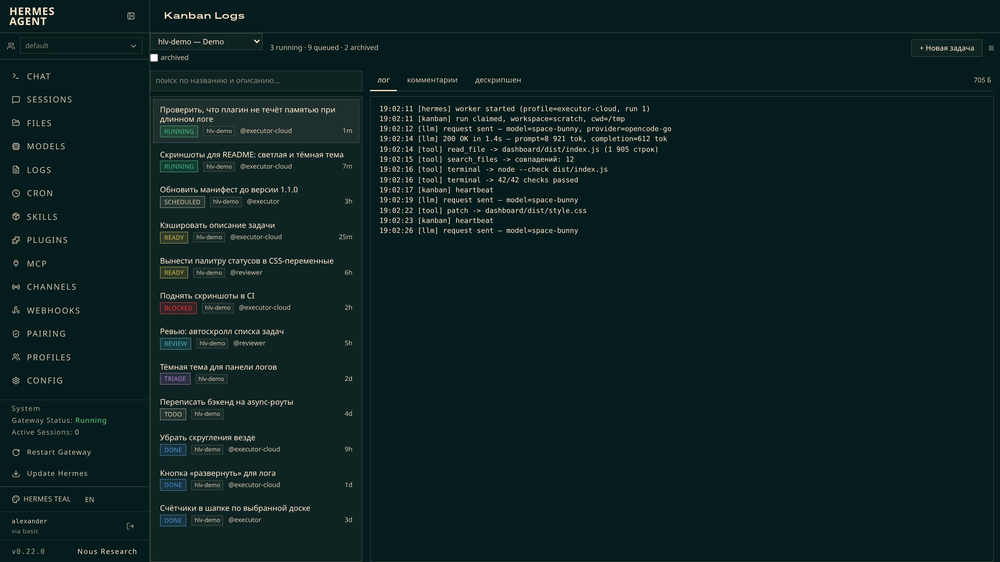
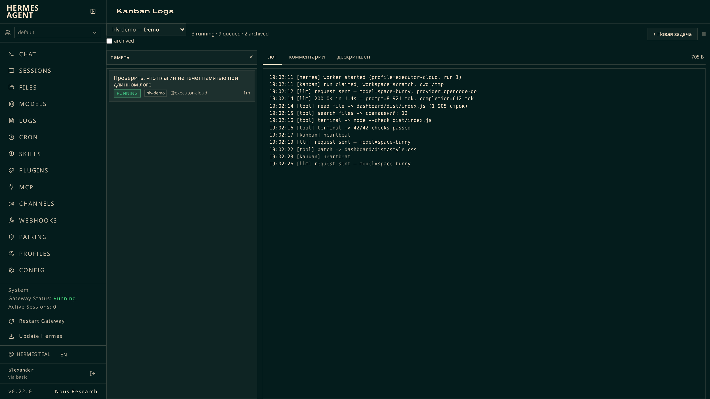
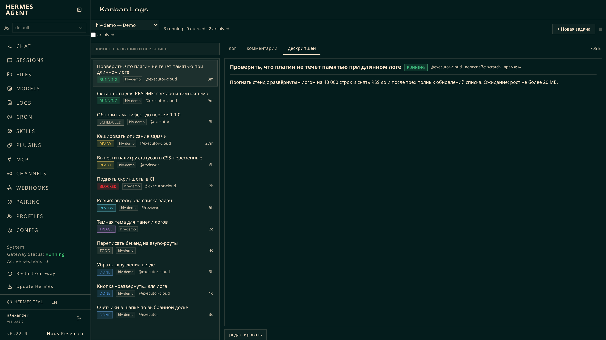
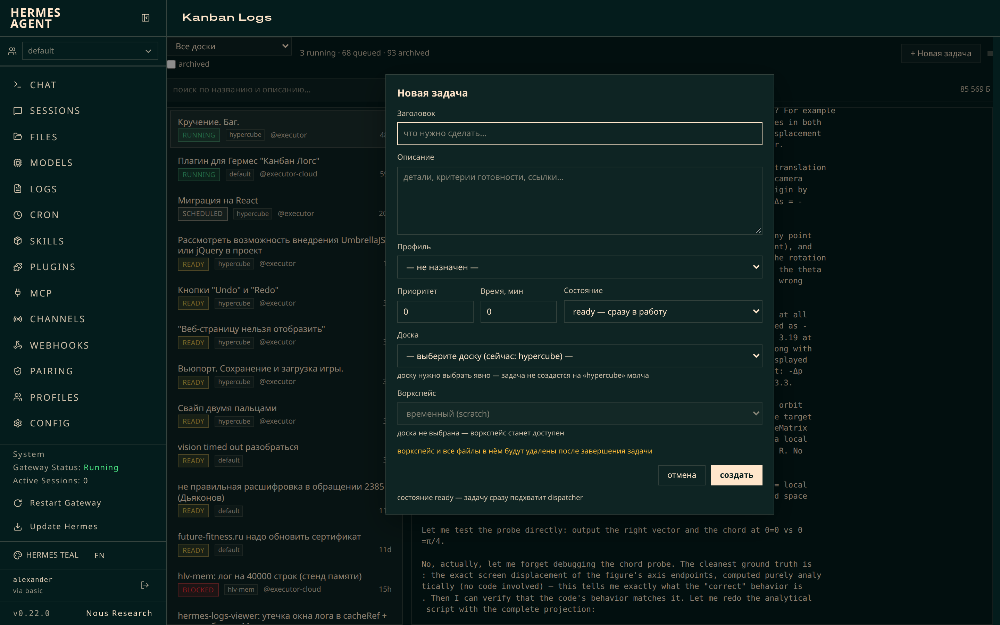
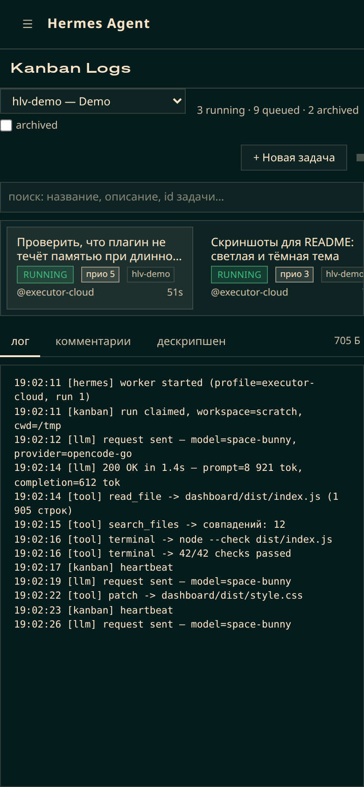
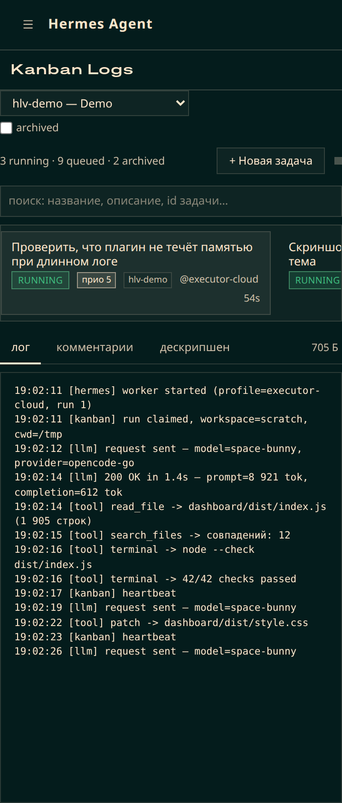

<div align="center">

# hermes-logs-viewer

**Живой лог воркера рядом со списком задач — отдельной вкладкой в дашборде Hermes.**

[](dashboard/manifest.json)
[](tests/render_test.js)


</div>

---



Вкладка **Kanban Logs** открывается в web-дашборде Hermes (`hermes dashboard`, порт 9119)
и показывает две половины одной работы: **слева** — все задачи всех досок, **справа** —
лог выбранной задачи, который догоняется вживую, пока вы не прокрутили вверх.

Ничего из этого не нужно настраивать: плагин не рисует ничего своего, кроме двух
панелей, и берёт доски, задачи, профили и лог из **встроенного плагина kanban**.

---

## Содержание

- [Что умеет](#что-умеет)
  - [Поиск по названию, описанию и номеру задачи](#поиск-по-названию-описанию-и-номеру-задачи)
  - [Живой лог](#живой-лог)
  - [Вкладка «основное»: карточка задачи целиком](#вкладка-основное-карточка-задачи-целиком)
  - [Комментарии](#комментарии)
  - [Новая задача](#новая-задача)
  - [Порядок задач в списке](#порядок-задач-в-списке)
  - [Мобильный вид](#мобильный-вид)
  - [Что показывает строка задачи](#что-показывает-строка-задачи)
  - [Доски и статусы](#доски-и-статусы)
- [Установка](#установка)
- [Скриншоты](#скриншоты)
- [Как это устроено](#как-это-устроено)
- [Проверка](#проверка)
- [Ограничения](#ограничения)
- [Лицензия](#лицензия)

---

## Что умеет

### Поиск по названию, описанию и номеру задачи



Над списком задач — строка поиска. Фильтр срабатывает **на каждое нажатие клавиши**:
ни Enter, ни debounce не нужны.

- ищет по **названию**, по **описанию** (`tasks.body`) и по **номеру задачи**,
  регистр не важен;
- **номер (`t_2d2e4f8f`) — полное совпадение по подстроке**, а не точное: номер
  пишут по памяти и копируют кусками, поэтому `t_2d2e` находит карточку
  `t_2d2e4f8f`. Номер не требует индекса — попадание видно на первом же
  нажатии, без ожидания `/board`;
- описание берётся из маршрута `/board` встроенного плагина — это единственный
  маршрут, который отдаёт тело целиком (в списке карточек лежит превью в 200 символов).
  Индекс строится один раз на доску и кэшируется, поэтому набор текста не ждёт сеть;
- пока запрос не пустой, индекс подтягивается раз в 15 с — правка описания или
  новая карточка не останутся «невидимыми» для поиска;
- пустой результат объясняется отдельной строкой («по запросу «…» ничего не найдено»),
  её нельзя спутать с пустой доской;
- крестик справа в поле очищает запрос.

### Живой лог

Правая панель — хвост `~/.hermes/kanban/logs/<task_id>.log` (для именованной доски —
`…/kanban/boards/<board>/logs/`).

- догружается инкрементально и **автопрокручивается вниз, пока вы не прокрутили вверх**;
- размер показан **точными байтами** («740 029 Б»), а не округлёнными мегабайтами:
  окно лога осмысленно только рядом с истинным размером файла. Человекочитаемый вид
  остался в подсказке;
- **«развернуть ⤢»** убирает `tail` — роут отдаёт весь файл с байта 0. Над окном
  появляется пометка «начало файла отсечено (показан хвост)», кнопка превращается
  в «свернуть ⤡»;
- в развёрнутом виде лимит строк выше (40 000 вместо 3 000) — окно растёт от начала
  файла, а не с хвоста;
- **состояние скролла запоминается на задачу**: были прижаты к низу — вернётесь к низу,
  читали определённое место — вернётесь к тому же отступу, и автопрокрутка не будет
  дёргать (появится кнопка «Вниз ↓»);
- пока первый кусок грузится — прелоадер, а не надпись «файла лога пока нет».

### Вкладка «основное»: карточка задачи целиком



Третья вкладка правой панели — вся карточка в одном месте: заголовок, шапка,
приоритет, состояние и тело задачи. Раньше эти вещи были размазаны по двум
вкладкам («дескрипшен» и «прочее»): чтобы поменять состояние, надо было
переключиться на соседнюю вкладку, а тело и заголовок правились в третьей.
Теперь всё, что можно менять у карточки, лежит рядом, и вкладка называется
**«основное»**.

> Снимок выше сделан до слияния вкладок — на нём ещё старое имя «дескрипшен».
> Переснять его нельзя без разрешения владельца репозитория (см. «Скриншоты»),
> поэтому картинка остаётся прежней, а подпись говорит, что на ней изображено.

Все правки идут через `PATCH /api/plugins/kanban/tasks/{id}` встроенного плагина,
поэтому новый роут не нужен и вкладка работает без перезапуска дашборда.

- **Заголовок** правится **карандашом рядом с ним**: `✎` открывает поле,
  `✓` сохраняет, `✕` отменяет. **Enter** — сохранить, **Esc** — отменить.
  Пустой заголовок **отклоняется** («заголовок не может быть пустым») — карточка
  не остаётся с безымянной заготовкой;
- **Описание** правится кнопкой «редактировать» — она превращает текст в
  textarea; сохранение — `PATCH` с `{body}`. **Ctrl/Cmd+Enter** — сохранить,
  **Esc** — отменить;
- **Приоритет** правится карандашом рядом со значением (Ctrl+Enter — сохранить,
  Esc — отмена). Нечисловое значение отклоняется с объяснением, а не молча
  превращается в 0 поверх настоящего приоритета;
- **Карандаш стоит справа от значения, которое правит** — у числа приоритета и
  у заголовка, на той же строке. Так он читается как «этот карандаш правит это
  число», а не как отдельная кнопка рядом;
- **Состояние** — кнопки по одному на статус, который роут действительно
  принимает: `triage`, `todo`, `ready`, `scheduled`, `blocked`, `review`, `done`,
  `archived`. Кнопка текущего состояния **неактивна**: PATCH в то же самое
  состояние — no-op, который всё равно пишет событие;
- **`running` кнопки нет намеренно** — роут отвечает на него 400
  («Cannot set status to 'running' directly», #19535): в `running` карточка
  попадает только через claim диспетчера. Предлагать кнопку, которая может
  только отказать, незачем;
- **`done`, `blocked`, `archived` спрашивают подтверждение** — они отпускают
  claim воркера. Ровно эти три подтверждает и встроенная вкладка;
- **Отказ маршрута виден пользователю.** Например, `complete_task` не даёт
  завершить карточку без `result`/`summary`
  (`completion blocked: … has no result or summary evidence`) — панель показывает
  этот текст, а не делает вид, что переход состоялся.

Шапка карточки: заголовок, бейдж статуса, аджайник, воркспейс и лимит времени
(`∞`, если 0 = бесконечно).

**Открытый редактор не затирает опрос.** Описание обновляется раз в 5 с, и
раньше проверка «не затирать открытый редактор» читала `descEdit` из замыкания
эффекта, который намеренно не depend от этой переменной (иначе опрос
перезапускался бы на каждом нажатии) — значение было заморожено на `false`
с момента открытия вкладки, и каждый тик подставлял в textarea тело с
сервера. Текст пропадал через 5 с, а на карточке с пустым описанием поле
просто гасло. Теперь флаг читается через ref: актуальное значение, опрос
сохраняет свою частоту. То же — для заголовка и приоритета.


### Комментарии

Вкладка «комментарии» — живая переписка по задаче: воркер пишет комментарии во время
работы, они появляются в треде без перезагрузки. Свои комментарии можно отправлять
из композера; они сразу появляются в списке, не дожидаясь опроса, и дубликаты по id
не рендерятся.

### Новая задача



Кнопка «+ Новая задача» в шапке открывает форму:

| поле | что это |
| --- | --- |
| Заголовок | обязательное, **Enter** — создать |
| Описание | тело карточки |
| Профиль | select из установленных профилей; **обязателен** |
| Приоритет | число, 0 = по умолчанию; выше — dispatcher берёт раньше |
| Время, мин | лимит времени воркера **в минутах**; **0 = бесконечно** |
| Состояние | `ready` (по умолчанию) / `todo` / `scheduled` / `triage` / `blocked` |
| Доска | любая доска из списка; **обязательна, выбирается явно** |
| Проект | **все проекты профиля**, с пометкой доски; свои — первыми; пусто = карточка без проекта; **открывается после выбора доски** |
| Воркспейс | `scratch` / `dir` / `worktree` + путь; **открывается после выбора доски** |

Девять решений, которые стоит знать:

- **Доска и профиль — обязательные.** Пока не выбраны, оба комбобокса обведены
  красным, а кнопка «создать» неактивна. Выбранное значение снимает красную
  рамку.
- **Профиль обязателен, потому что без него карточка не выполняется.**
  Диспетчер берёт из полосы `ready` только карточки с назначенным профилем
  (`kanban_db_dispatch._lane_rows` + `_dispatch_lane_task`); неназначенная
  карточка лежит в `ready` и ждёт вечно. На живом дашборде это видно в логе
  gateway: «kanban dispatcher stuck: ready queue non-empty for N consecutive
  ticks but 0 workers spawned». Если у вас настроен
  `kanban.default_assignee`, неназначенные карточки всё же забираются — но это
  настройка оператора, а не выбор формы, поэтому полагаться на неё нельзя.
- **Доска требуется явно.** Форма открывается с пустым значением и без выбранной
  доски не создаётся — задача не может молча упасть на `default` или на доску,
  случайно оставленную в фильтре шапки.
- **Воркспейс заблокирован, пока не выбрана доска.** Он выводится из доски
  (`default_workdir` + `default_workspace_kind`), и выбор доски его
  перезаписывает. Если бы поле было активно раньше, любой выбор пользователя
  молча пропал бы через одно нажатие. Поэтому `select` и путь помечены
  `disabled`, под полем стоит подсказка «доска не выбрана — воркспейс станет
  доступен», а в `title` — «сначала выберите доску».
- **Время в минутах, а API в секундах.** Поле «Время, мин» — это то, в чём человек
  планирует; в БД уходит `max_runtime_seconds`, поэтому конвертация
  (`минуты × 60`) делается один раз при отправке. 30 в поле = 1800 секунд лимита.
  В форме это проверяется сквозным тестом, а не только на глаз.
- **Вид воркспейса: доска задаёт базу, проект с репозиторием — перекрывает.** Стоит
  выбрать доску, форма берёт её `default_workspace_kind` — `worktree`, если
  каталог доски внутри git-репозитория, иначе `dir`, без каталога — `scratch`.
  **Если выбран проект, у которого `primary_path` — git-репозиторий, вид
  становится `worktree`**, даже если доска предлагала `dir`. Это важно для доски
  `ff`: её `default_workdir` — контейнер `/home/alexander/src/ff`, а не
  репозиторий, поэтому её `default_workspace_kind` всегда `dir`, и без этого
  правила ни один её проект не предложил бы worktree, хотя ветки там создаются
  прекрасно. Проект **без** репозитория оставляет вид как у доски.
  Правило реализовано в `kindForProject` и действует только на значение **по
  умолчанию** — вид всегда можно переключить руками. Смена доски пересчитывает вид
  по доске, а затем, если проект остался выбран, применяет правило проекта.
  Полная таблица пар «вид × наличие проекта» — ниже.
- **Создание идёт через API встроенного плагина kanban**, поэтому карточка
  неотличима от созданной во вкладке Kanban: своя строка в БД, событие `created`,
  резолв воркспейса и проекта доски.
- **`todo`, `scheduled` и `blocked` не создаются «из коробки»** — карточка сначала
  появляется в `ready`, а потом переводится тем же `PATCH`, которым встроенная
  вкладка двигает карточку перетаскиванием. Если перевод не прошёл с первой
  попытки, плагин пробует ещё раз; если и это не помогло — **пишет в шапку, в
  каком состоянии карточка на самом деле**, вместо молчаливого «создано».
- **`scheduled` — это «отложена, но не сломана».** Карточка в этом состоянии
  ждёт времени, а не человека: dispatcher её **не берёт** (в его полосах только
  `ready` и `review`), claim с неё снимается, а вернуть её в работу можно
  переводом в `ready` — ровно так же, как это делает встроенная вкладка
  кнопкой «→ scheduled».

#### Проект: список и якоря

**Проект не обязан быть привязан к доске.** `projects.board_slug` — это nullable
колонка, и она означает «где проект используется», а не «где ему можно
использоваться»:

- проект, созданный без `--board`, имеет `board_slug = NULL` — и под фильтром
  «проекты этой доски» он был бы недостижим **на всех** досках сразу;
- `kanban_db._resolve_project_link` **никак не проверяет принадлежность доске**,
  поэтому карточку с проектом другой доски создать можно и нужно. Фильтр по
  доске запрещал бы легальный вызов.

Поэтому список — **все проекты профиля**, упорядоченные по принадлежности:

1. проекты, привязанные к **этой** доске;
2. проекты, привязанные к **другой** доске;
3. непривязанные (`board_slug` пуст).

Каждый вариант помечен принадлежностью, иначе выбор нечитаем:
`FF Front · ff`, `Hyper-Cube · hypercube`, `Что-то ещё · без доски`. Под полем
пишется, сколько из них относится к другой доске. Поле заблокировано, пока не
выбрана доска: без неё нечего сортировать. Пустое значение = карточка без проекта.

**Смена доски выбор не сбрасывает** — проект остаётся выбранным и переанкоривает
путь на новой доске. Сбрасывается только проект, **исчезнувший из списка**
(например, архивнутый посреди заполнения формы): в payload не должен уйти
`id`, которого больше нет.

Проект — это **якорь**, и `kanban_db._resolve_project_link` трактует его по-разному
в зависимости от вида воркспейса. Форма следует за ядром, иначе карточка выполнится
не там, где показал селектор. Полная таблица — вид × наличие проекта:

| воркспейс | проект выбран | проект не выбран |
| --- | --- | --- |
| `dir` | `project_id` + `workspace_path = primary_path` проекта → путь **каталога проекта** | `workspace_path` = `board.default_workdir` |
| `worktree` | `project_id`, **без `workspace_path`** → ядро само создаёт `<primary>/.worktrees/<task-id>` и ветку `<slug>/<task-id>-<title>` | `workspace_path` = `board.default_workdir`, ветка — случайная `wt/<id>` |
| `scratch` | **ничего** (явный opt-out из проекта, #106342) → `project_id` = NULL | **ничего** → `project_id` = NULL |

Итого по приоритету: **проект перекрывает доску** в строке `dir` (путь) и в
строке `worktree` (путь убирается целиком, корень и ветку задаёт проект); в
`scratch` проект не отправляется вовсе.

Почему именно так — доска `ff` как контрпример. Её `default_workdir` =
`/home/alexander/src/ff` — это **контейнер, а не git-репозиторий**
(`_git_toplevel` возвращает `None`); три репозитория лежат внутри него. Отсюда:

- **`project_id` не подставляет путь для вида `dir`.** Ядро берёт путь из
  `board.default_workdir`. Карточка «проект `ff-front` + `dir`» без явного пути
  выполнилась бы в `/home/alexander/src/ff`, а не в
  `/home/alexander/src/ff/ff-front-v1`. Поэтому форма **подставляет
  `workspace_path = project.primary_path`** — это не украшение, а условие того,
  что выбор проекта вообще имеет смысл. Путь остаётся редактируемым: подстановка
  задаёт значение по умолчанию, но ручная правка выигрывает.
- **Для `worktree` путь убирается из payload, но не из поля.** Ядро материализует
  `<primary>/.worktrees/<task-id>` только пока путь не прислан
  (`_resolve_project_link` ставит `project_repo` под `workspace_path is None`).
  Оставшийся от доски `default_workdir` перебил бы якорь — и worktree не
  создался бы вовсе, потому что контейнер не репозиторий. Поэтому `workspace_path`
  **не отправляется никогда**, а поле «Путь» показывает **предпросмотр** того, что
  `create_task` создаст:

  ```
  /home/alexander/src/ff/ff-mobile/.worktrees/<id-задачи>
  ```

  Поле помечено «Путь (предпросмотр)», отдаётся `readOnly` (не `disabled`, чтобы
  значение можно было прочитать и скопировать), а в `title` и подсказке сказано,
  что значение в задачу не уходит и вводить своё нельзя. Раньше поле было пустым с
  одной текстовой подсказкой — это читалось как «не задано», и естественная
  реакция (вписать каталог доски) ломала якорь. Предпросмотр убирает саму
  причину: видно, что значение уже есть и его незачем вводить.

  Правило «не отправлять» продублировано в `submitCreate`, а не держится только на
  read-only: якорь worktree не должен зависеть от того, что поле кто-то не
  отредактирует. Обратный случай — **worktree без проекта** — оставлен как был: там
  путь это репозиторий, от которого ветвятся, и его отправлять нужно.
- **Механизм не срабатывает в другую сторону:** у `dir` ветки нет вовсе
  (`branch_name` = NULL) — она выводится только для `worktree`.

**Форма не полагается на `board.json.project_id`.** Ядро подставляет проект доски
автоматически, когда `project_id is None` и вид не `scratch`. У доски `ff` это
поле сейчас `null`, но полагаться на это нельзя: заполни его — и явный выбор
проекта в форме начнёт молча перебиваться. Поэтому выбранный проект уходит
**явным `project_id`**, а пустой выбор — **полным отсутствием ключа** в payload
(не `null`, не `""`). Так карточка без проекта остаётся без проекта независимо от
настройки доски.

**`scratch` — это явный opt-out из проекта** (#106342), и решение зафиксировано:
при виде `scratch` проект **не отправляется вообще**, селектор проекта при этом
**блокируется**, а под ним показывается подсказка «воркспейс scratch — проект не
привязывается, карточка одноразовая». Отправлять и проект, и `scratch` нельзя:
ядро прочитает проект как «привяжи меня к этому репозиторию» и либо повысит вид
до `worktree`, либо выдумает worktree — то есть UI показал бы одно, а карточка
сделала бы другое. Проект без `primary_path` — единственный случай, где корень
неизвестен, поэтому форма отказывается создавать карточку и объясняет почему.

Всё это проверяется двумя способами:

- `tests/render_test.js` — **что уходит в payload**: пересборка списка и сброс
  чужого проекта, `dir` → `workspace_path` проекта (и что он **не** равен
  `default_workdir` доски), `worktree` → `workspace_path` **отсутствует**,
  пустой проект → `project_id` **не отправляется вовсе**;
- `tools/anchor_probe.py` — **что ядро делает с этим payload**: вызывает
  `create_task` напрямую и читает строку обратно, сверяя
  `<primary>/.worktrees/<task-id>`, детерминированную ветку и то, что
  `project_id` не подставился из доски.

### Порядок задач в списке

Порядок групп статусов — `running`, `ready`, `scheduled`, `blocked`, `review`,
`triage`, `todo`, `done`, `archived`. **`scheduled` стоит после `ready` намеренно:**
отложенная карточка ждёт времени и воркером не берётся (`schedule_task`), поэтому
она не должна читаться как «следующая в очереди».

Внутри одного статуса карточки стоят не по свежести heartbeat, а по тому, что
реально важно для этого статуса:

| статусы | порядок внутри группы |
| --- | --- |
| `ready` | **как в диспетчере: `priority DESC, created_at ASC`** |
| `running` | **по приоритету, затем кто стартовал раньше** |
| `done`, `archived` (завершённые) | **по времени завершения, свежие сверху** |
| остальные (`todo`, `blocked`, `review`, `triage`, `scheduled`) | **по приоритету, больший сверху** |

- **`ready` — это очередь запуска, и она показывает настоящий порядок запуска.**
  Взято буквально из `kanban_db_dispatch._lane_rows`:
  `ORDER BY priority DESC, created_at ASC`. Общее правило «по приоритету, при
  равенстве — свежая активность» для `ready` давало бы обратный порядок, и список
  обещал бы in-progress, которого диспетчер не выполнит. Первая строка `ready` —
  это та карточка, которая следующей уйдёт в работу.
- **`running` не переставляется от heartbeat.** Раньше вторичным ключом был
  `last_heartbeat_at`, а он меняется каждый heartbeat: две карточки с одинаковым
  приоритетом менялись местами, когда одна из воркеров просто что-то отвечала, и
  список перетасовывался под курсором на живой доске. Теперь у `running`
  вторичный ключ — `started_at`: стабилен весь запуск и тоже осмыслен (кто дольше
  работает — тот выше).
- у завершённой карточки приоритет уже ничего не решает — она не в очереди,
  поэтому «что закончилось последним» полезнее, чем «что было важнее»;
- у остальных живых карточек при равном приоритете решает свежесть активности,
  затем `board` и `id` — порядок стабилен и не «прыгает» между опросами.

Правило одно и то же в бэкенде (`_sort_key` в `plugin_api.py`) и во фронтенде
(`taskSortKey`), поэтому карточка, вставленная сразу после создания, попадает
туда же, куда её поставил бы следующий опрос. Обе реализации проверяются
собственным набором тестов, который сравнивает результат с `ORDER BY`
диспетчера, а не с повторной реализацией того же правила.

### Мобильный вид

На узком экране список задач становится **горизонтальным** — и вариант зависит
от ширины: **выше 380px это список**, а **на 380px и уже — карусель**.





Общая часть (медиазапрос `max-width: 1023px`) у них одна:

- прокрутка идёт **по X** (`overflow-x: auto`), по Y она заблокирована;
- **автоскролл списка работает по той оси, по которой список реально скроллится**
  (`isCarousel()` → `scrollLeft` вместо `scrollTop`), поэтому выбор карточки
  на телефоне долистывает её вбок, а не пытается сдвинуть список вверх;
- на десктопе медиазапрос не действует и список остаётся вертикальной колонкой.

Чем варианты отличаются и почему граница именно такая:

| ширина списка | вариант | карточка | scroll-snap |
| --- | --- | --- | --- |
| **> 380px** | горизонтальный **список** | `clamp(200px, 45%, 320px)` — в кадре несколько карточек | выключен (`none`) |
| **≤ 380px** | **карусель** | `82%` — одна карточка, следующая выглядывает | `x mandatory`, примагничивание к левому краю |

- **«одна карточка на экран» — это не универсально хорошая форма.** На 390px
  она съедала всю строку: одна задача, лог уезжал под сгиб, а листать нужно
  было по одной карточке. Выше 380px в ту же строку влезает несколько
  карточек — и список читается как список;
- **ниже 380px вторая карточка была бы обрезком** вроде «Скиллы для…», и
  постраничное листание честнее: карточка читается целиком, палец знает, что
  справа есть ещё;
- у карточек в обоих вариантах **чипы мета-строки переносятся**, а не
  обрезаются: статус, приоритет, доска, профиль, комментарии и время не
  помещались в одну строку, и хвост исчезал за `overflow: hidden` без всякой
  подсказки.

Правило проверяется в **настоящем Chromium** на трёх вьюпортах — 390px (список),
360px (карусель) и 1440px (вертикальная колонка): `tests/carousel_test.js`.

### Что показывает строка задачи

Под заголовком карточки идёт мета-строка: **статус, приоритет, доска, профиль,
число комментариев, «сколько минут назад»**.

- **приоритет подписан у каждой карточки**, включая `прио 0`. Список отсортирован
  именно по нему, поэтому число, по которому выстроен порядок, обязано быть
  видно; `0` — тоже значение («явного приоритета нет»), а не «данных нет», и
  прятать его было бы тем же несоответствием;
- подпись берётся из `sortInputs(t)` — того же значения, по которому считается
  порядок и пишется `data-priority`, поэтому бейдж не может разойтись с
  позицией карточки;
- стенд сверяет подпись с `data-priority` **и** с живой доской (`/board`), а не
  с константой из самого плагина.

### Доски и статусы

- селектор доски в шапке фильтрует список; первым идёт «Все доски» (слитый вид).
  Выбор помнится в `localStorage` и переживает перезагрузку; пропала доска —
  фильтр сам возвращается к «Все доскам»;
- **подпись доски видна целиком.** Раньше селектор был ограничен 180px, а
  нативный `<select>` не ставит многоточие, а просто обрезает текст: на этих
  данных `hlv-mem — Bench (memory)` не помещался на 23px, а
  `hypercube — Hyper-Cube` — на 8px, и закрытый селектор читался как
  «hypercube — Hyp…» — то есть как сломанный переключатель. Теперь у него
  свой класс `.hlv-board-select` (`width: auto; max-width: 100%`), и полная
  подпись дублируется в `title` на случай, когда места правда не хватает;
  фактическое обрезание меряется в браузере относительно неограниченного
  двойника того же селектора (`tools/board_label_fit.js`), а не «на глаз»;
- чекбокс **«archived»** живёт под селектором досок, в одном блоке;
- у каждого из **9 статусов свой цвет бейджа** — палитра взята из встроенного
  плагина kanban (`.hermes-kanban-dot-*`), а не придумана здесь;
- счётчики в шапке считают **то, что показано** (при выбранной доске — её задачи);
- активные задачи (`running` → `scheduled` → `ready` → …) сверху, `archived` внизу,
  а внутри группы — по правилу из
  [«Порядок задач в списке»](#порядок-задач-в-списке).

---

## Установка

Нужен установленный Hermes с плагином kanban (он ставится вместе с дашбордом).

```bash
git clone https://github.com/alex-dubatov/hermes-logs-viewer.git
cd hermes-logs-viewer

# 1. положить плагин в ~/.hermes/plugins/
cp -r dashboard ~/.hermes/plugins/hermes-logs-viewer

# 2. включить его (без этого не смонтируется backend)
hermes plugins enable hermes-logs-viewer

# 3. открыть дашборд
hermes dashboard --no-open
```

Вкладка **Kanban Logs** появится в левой навигации дашборда.

**Обновление.** Правки **frontend** (`dist/`) подхватываются перезагрузкой страницы —
ассеты отдаются с `no-store`, перезапуск дашборда не нужен. Правка
`plugin_api.py` (добавление/удаление роутов) требует
`systemctl --user restart hermes-dashboard`.

---

## Скриншоты

> **Не обновлять скриншоты без разрешения владельца репозитория** (правка от
> 2026-10-19, усилена 2026-10-21). Нижеперечисленные команды **перезаписывают**
> committed PNG в `docs/`, а `seed_demo.js` вдобавок создаёт **настоящую** доску
> на живом дашборде. Обе вещи делать без спроса нельзя — владелец обнаружил это
> сам, по факту. Даже если новая функция явно «просится» на картинку: спросить
> заранее дешевле, чем объясняться постфактум. Если разрешение получено —
> обязательно закончить `seed_demo.js --clean`, чтобы не оставить доску.
>
> **Не создавать задачи ради скриншотов** (2026-10-21). Правило касается и
> подготовки данных, а не только самой съёмки: демо-карточки для картинок не
> создаются без спроса. Для проверки функциональности задачи на живом дашборде
> не нужны — есть стенды (`tests/render_test.js`, `tests/carousel_test.js`),
> которые проверяют DOM и поведение. Полное правило для агентов —
> [`AGENTS.md`](AGENTS.md).

Все картинки в этом README сняты с **живого дашборда** и показывают
**фиктивные данные** — доска `hlv-demo`, которая создаётся скриптом и удаляется
вместе с логами. Ни одно настоящее название задачи в репозиторий не попадает.

```bash
# 1. живую сессию дашборда в cookie jar
curl -s -c /tmp/hlv.cookies -X POST http://127.0.0.1:9119/auth/password-login \
  -H 'Content-Type: application/json' \
  -d '{"provider":"basic","username":"<user>","password":"<pass>"}'

# 2. фиктивные задачи на одноразовой доске hlv-demo
node tools/seed_demo.js

# 3. снимки в docs/
node tools/screenshots.js
node tools/narrow_shots.js        # оба варианта узкой вёрстки (список и карусель)

# 4. убрать доску вместе с логами
node tools/seed_demo.js --clean
```

`tools/check_screenshots.js` прогоняет тот же сценарий и **проверяет DOM** в каждой
точке съёмки — что в кадре действительно демо-доска, что поиск сузил список, что
лог непустой. Так утверждения README проверяются, а не предполагаются:

```bash
node tools/check_screenshots.js     # 20/20 проверок кадра
```

`tools/narrow_shots.js` снимает обе узкие вёрстки и **сам себя проверяет**: на
390px он ждёт в кадре больше одной карточки при выключенном snap, на 360px —
`x mandatory`, и снимок делается только если сценарий совпал. Иначе старая
картинка в README расходилась бы с CSS молча.

Путь до Playwright и Chromium переопределяется переменными `PLAYWRIGHT_PATH`
и `CHROME_PATH`.

---

## Как это устроено

```
~/.hermes/plugins/hermes-logs-viewer/
├── dashboard/
│   ├── manifest.json     # регистрация вкладки
│   ├── plugin_api.py     # свой backend: только то, чего нет у kanban
│   └── dist/
│       ├── index.js      # весь фронтенд, один IIFE без сборки
│       └── style.css     # только CSS-переменные дашборда, скруглений нет
├── tests/render_test.js  # стенд: jsdom + живой дашборд, клики по настоящему UI
├── tools/                # демо-данные, скриншоты и anchor_probe.py для README
└── docs/                 # картинки README
```

**Фронтенд** — один IIFE-скрипт без сборки. Он берёт React и `fetchJSON` из
`window.__HERMES_PLUGIN_SDK__` и регистрирует вкладку через
`window.__HERMES_PLUGINS__.register`.

**Почти всё backend-а своего плагина не имеет.** Списки досок, профили, создание
задачи, описание и сам лог берутся из `/api/plugins/kanban/…`. Это не оптимизация,
а требование доступности: роутер встроенного плагина монтируется при старте процесса
и потому **всегда живой**, тогда как новый роут здесь доезжает до браузера только
после `systemctl --user restart hermes-dashboard` — а перезапуск из headless-режима
недоступен. Своя копия этих эндпоинтов ещё и расходилась бы с оригиналом.

Свой `plugin_api.py` отдаёт ровно то, чего у встроенного плагина нет:

| маршрут | зачем |
| --- | --- |
| `GET /tasks/all` | все задачи **всех досок** слитым списком; доска с битой/отсутствующей БД пропускается, чтобы одна сломанная доска не скрыла остальные |
| `GET/POST /tasks/{id}/comments` | комментарии: вставка в `task_comments` + событие `commented`, как в `kanban_db.add_comment` |
| `GET /projects[?board=]` | проекты с их `board_slug` и `primary_is_repo` — то, чего у встроенного плагина нет (см. ниже) |

**Проекты пришлось добавить здесь, и это не обход.** Встроенный плагин не умеет
отвечать на вопрос «проекты какой доски»:

- `GET /api/plugins/kanban/boards` отдаёт `project_name` — **имя одного** проекта,
  а именно того, что прописан в самой `board.json.project_id` доски (у `ff` это поле
  `null`, так что приходит `null`);
- `GET /api/plugins/kanban/projects` перечисляет все проекты, но **без
  `board_slug`** — в ключах ответа его нет вовсе, и **без признака «репозиторий»**.

Связь доска↔проекты (`projects.board_slug` в per-profile `projects.db`) не
отдаётся ни одним из них, поэтому селектор проектов на них построить нельзя.
Роут читает эту колонку напрямую.

`primary_is_repo` считается самим роутом: `git -C <primary_path> rev-parse
--show-toplevel`, с кэшем по пути и таймаутом в 5 секунд (поллинг идёт раз в
15 с, без кэша это был бы процесс на каждый ответ). Поле необязательное:
отсутствие или `null` читается как «не репозиторий», и форма откатывается к
рекомендации доски. «Репозиторий» — свойство файловой системы, а не строки в БД,
поэтому колонки в `projects` для этого быть не может.

Что стоит поправить **в `hermes_cli`**: добавить `board_slug` **и** признак
репозитория в ответ встроенного `GET /projects` — тогда отпадает и этот роут, и
лишний перезапуск дашборда.

Проекты — **per-profile** база (`$HERMES_HOME/projects.db`), в отличие от досок,
которые по замыслу общие для всех профилей. Поэтому роут ищет её по `HERMES_HOME`
и намеренно **не** переиспользует `_kanban_root()`: тот для `<root>/profiles/<name>`
поднимается на два уровня и указал бы на чужой профиль. `project_folders` не
читается — якорь всегда строится на `primary_path`, лишние папки форме нечего
показать.

Чтение канбан-БД и `projects.db` — только `mode=ro`. Запись — только комментарий.
`hermes_cli` не импортируется вовсе, что держит тестовый стенд автономным.

Частота опроса: список задач 2 с, лог 1.2 с, комментарии 5 с, доски 15 с,
профили 30 с, сторожевой таймер автоскролла 0.5 с.

---

## Проверка

`tests/render_test.js` — стенд, который грузит `dist/index.js` в **jsdom**,
поднимает настоящий React и ходит в **живой дашборд**, после чего кликает по
реальному UI. **181 проверок**: раскладка шапки (включая то, что подпись доски
помещается в селектор и у него есть `title`), правила бейджа для всех 9 статусов,
отсутствие скруглений, поиск (по названию, по описанию, **по номеру задачи и по
его началу**, пустой результат, крестик), вкладка «основное» с живым
round-trip правки описания и **проверкой, что опрос не затирает набираемый
текст** (стенд ждёт 6.5 с — дольше периода опроса в 5 с — и убеждается, что
textarea цела; правка отменяется, карточка остаётся нетронутой), форма новой
задачи (пустая доска по умолчанию, отказ создать без доски, **блокировка
воркспейса до выбора доски и её снятие после**, **время в минутах → 1800 секунд
в БД**, состояние ready, предложение worktree/dir/scratch по доске, перевод
созданной карточки в `todo` и отсутствие вранья в результате создания), а также
выбор проекта: список содержит **все** проекты профиля, порядок «свои → чужие →
непривязанные», подписи с принадлежностью (`· ff`, `· без доски`), **выбор
сохраняется при смене доски**, непривязанный и «чужой» проекты доступны и
реально создают карточку с правильным якорем — и, главное, **payload, который
реально ушёл в `POST /tasks`** (`dir` → путь проекта и что он не равен
`default_workdir` доски, `worktree` → пути нет вовсе, пустой проект →
`project_id` не отправляется, `scratch` → проект не отправляется).

Обязательность доски и профиля проверяется отдельно и **двумя путями**: кликом
по неактивной кнопке и **Enter**, который идёт мимо кнопки прямо в
`submitCreate`. Для обоих путей стенд смотрит не только на текст ошибки, но и
на то, что `POST /tasks` **не ушёл** вообще, иначе отказ мог бы быть
декоративным. Отдельно проверяется, что красная рамка (`hlv-required`) есть у
обоих комбобоксов до выбора и **снимается** после него.

Состояние `scheduled` проверено сквозным round-trip: карточка создаётся в
`ready`, состояние ставится тем же `PATCH`, что и во встроенной вкладке, и
карточка **реально оказывается в `scheduled`** — без claim и без run, то есть
диспетчер её не подхватит. Там же проверяется, что на карточке стоит именно
тот профиль, который форма обязала выбрать.

Карточки, которые создаёт стенд, получают профиль **`default`**: он
установлен на любой машине, и под ним не крутится воркер. Назначение на живой
профиль опасно — карточка в `ready` с таким профилем уходит диспетчеру в
течение одного тика (60 с) и **реально выполняется**.

Отдельно проверяется **подпись приоритета**: у каждой строки она есть, число
совпадает с `data-priority` и с живой доской (`/board`), и `прио 0` показан
явно — иначе «приоритет подписан» проходило бы на сборке, где бейджа нет вовсе.

Узкая вёрстка проверяется по самой таблице стилей (jsdom медиазапросы не
применяет): общая часть задаёт ось и не задаёт ширину карточки, вариант
`381px…1023px` — список без постраничного snap, вариант `≤380px` — карусель с
`82%` и `x mandatory`.

Вид воркспейса и предпросмотр пути покрыты отдельно: доска с нерепозиторным
workdir + проект с репозиторием → вид `worktree`; без проекта вид остаётся как у
доски; проект без репозитория → вид доски; поле пути при `worktree` — `readOnly`
с предпросмотром `<primary>/.worktrees/`, который пересчитывается при смене
проекта; и главное — **`workspace_path` в payload не появляется, хотя поле
заполнено**, а карточка в БД получает якорь проекта.

Непривязанного проекта в живых данных может не быть, поэтому стенд **засевает**
его на время прогона и удаляет после: иначе «непривязанные доступны» проверялось
бы на пустом множестве и проходило не по той причине. Так же засевается проект
**без репозитория** — иначе «вид остаётся как у доски» было бы нечем проверять.

`tools/anchor_probe.py` проверяет вторую половину контракта — что **ядро** делает
с этим payload. Он вызывает `kanban_db.create_task` напрямую теми же телами,
которые отправляет форма, читает строку обратно и сверяет `<primary>/.worktrees/
<task-id>`, детерминированную ветку `<slug>/<task-id>-<title>` и то, что
`project_id` не подставился из `board.json.project_id`. Отдельно проверяется
**проект с чужой или пустой `board_slug`**: карточка принимается, привязывается к
проекту, и якорь остаётся за проектом, а не за доской — ради этого сценария
непривязанный проект засевается и удаляется, как и в стенде. Созданные карточки и
засеянный проект удаляет за собой.

```bash
env -u HERMES_HOME python3 tools/anchor_probe.py ff ff-front
```

Отдельно проверяется **порядок списка**: стенд идёт по отрисованным строкам и
требует, чтобы внутри статуса `done`/`archived` время завершения шло по убыванию,
а внутри остальных — приоритет. Проверка не самообманывается:

- у неё есть **негативный контроль** — заведомо неверный порядок должен быть
  пойман (иначе инвертированное сравнение проходило бы вечно);
- она **сверяется с доской**: значения `data-priority` / `data-completed-at` в
  строках сравниваются с тем, что отдаёт встроенный `/board`, так что список не
  может быть «правильно отсортирован по выдуманным константам».

```bash
curl -s -c /tmp/hlv.cookies -X POST http://127.0.0.1:9119/auth/password-login \
  -H 'Content-Type: application/json' \
  -d '{"provider":"basic","username":"<user>","password":"<pass>"}'

node tests/render_test.js                                # исходники
node tests/render_test.js /tmp/served/dist/index.js      # то, что реально отдаёт дашборд
```

`tests/carousel_test.js` — вторая половина проверки, **настоящий Chromium**:
jsdom не применяет медиазапросы и не верстает, поэтому горизонтальные варианты
можно доказать только в браузере. **21 проверка**, три вьюпорта:

- **390px** — горизонтальный **список**: `flex-direction: row`, `overflow-x: auto`,
  по Y заблокировано, полоса шире экрана, `scroll-snap-type: none`, **в кадре
  больше одной карточки**, карточка заметно уже экрана; выбор карточки двигает
  `scrollLeft` (а `scrollTop` остаётся нулём) и карточка попадает в кадр;
- **360px** — **карусель**: карточка чуть уже экрана, примагничивание к левому
  краю, `scroll-snap-type: x mandatory`;
- **1440px** — список возвращается вертикальной колонкой (защита от регрессии).

Там же проверяется **подпись приоритета** в отрисованных карточках (её нет ни
на одной, число совпадает с `data-priority`) и **поиск по номеру задачи**
(ровно одно совпадение). Отдельно — **обрезка подписи доски**: она измеряется
относительно неограниченного двойника того же селектора, а не «на глаз» и не по
зашитой ширине стрелки; именно на этом проверялась правка `.hlv-board-select`.

```bash
PLAYWRIGHT_PATH=<путь к playwright> CHROME_PATH=<путь к chrome> \
  node tests/carousel_test.js          # 21/21 checks passed
```

**Геометрия вкладки «основное»** проверяется отдельно — `tools/pane_layout_check.js`
(настоящий Chromium, живой дашборд). jsdom не верстает, поэтому в нём не видно
сломанной коробки, а сломана она была: панель и обёртка макета носили **один
класс** `hlv-main`, и правило обёртки (`display: flex` + строка) раскладывало
четыре элемента карточки (шапка, приоритет, состояние, тело) **в одну строку**
вместо стопки. Проба меряет геометрию: элементы панели идут сверху вниз, панель
занимает только правую половину, обёртка осталась строкой, и ни один элемент
не вылезает за пределы своей панели. Панель ищется **структурно** (по строке
заголовка внутри неё), а не по классу: класс панели — ровно то, в чём был баг,
и поиск по классу нашёл бы панель только когда бага нет. Тот же замер идёт и на
узком экране (390px), где макет переключается в колонку: стопка должна
остаться стопкой.

Там же меряется **место карандаша**: он стоит **справа от значения**, которое
правит, — справа от числа приоритета и справа от заголовка, на той же строке.
Это обещание вёрстки, и jsdom его не видит: карандаш, съехавший влево или на
свою строку, перестал бы читаться как «этот карандаш правит это число».
Негативный контроль на месте: с карандашом, сдвинутым влево, проба падает
ровно на этой строке.

```bash
PLAYWRIGHT_PATH=<путь к playwright> CHROME_PATH=<путь к chrome> \
  node tools/pane_layout_check.js      # 12/12 checks passed
```

`tools/css_probe.js` — та же проверка **без браузера**: он грузит настоящую
таблицу стилей в jsdom и спрашивает у CSS-движка, что панель вычисляется в
(`display`/`flex-direction`). Быстрый, без живого дашборда.

```bash
node tools/css_probe.js                 # OK: панель «основное» — вертикальный поток
```

Отдельные пробы дашборда, которыми и находились причины:

```bash
node tools/board_probe.js      # что селектор вообще делает: значение, опции, фильтр, localStorage
node tools/board_label_fit.js  # помещается ли подпись (сравнение с неограниченным двойником)
```

Первая из них заодно объясняет, почему страницу надо открывать как
`/hermes-logs-viewer?profile=default`: дашборд иначе уводит браузер на
`/sessions?profile=<ваш профиль>` и вкладка не монтируется вовсе.

Скриншоты проверяются отдельно — см. [«Скриншоты»](#скриншоты).

---

## Ограничения

- вкладка — отдельная страница дашборда (левая навигация, не канвас);
- показываются логи текущего процесса воркера; после завершения задачи файл остаётся;
- лог не ротируется плагином, но ядро ограничивает файл 2 МБ. Если файл всё же
  длиннее лимита в 40 000 строк, показываются первые строки с пометкой, сколько
  отброшено;
- размер и смещение показаны в **байтах**; в подсказке — человекочитаемый вид и
  число строк;
- backend плагина нужен только ради сквозного списка задач и комментариев.

---

## Лицензия

[MIT](LICENSE)